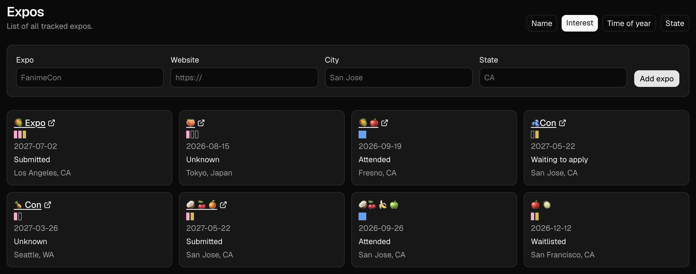
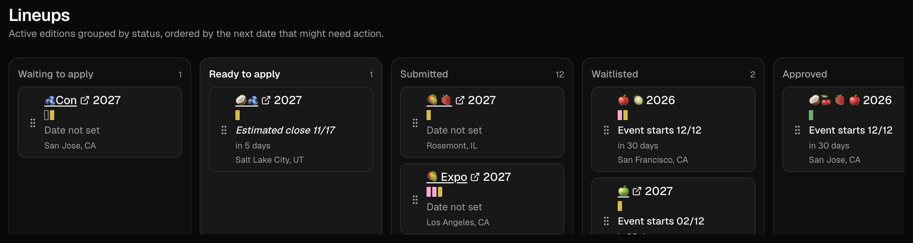
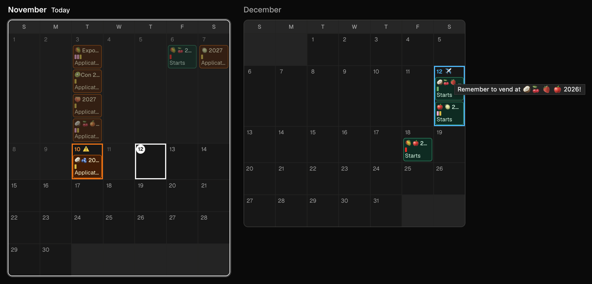

# Expo Tracker

Browser-local app for tracking artist-alley / vendor applications to recurring cons and expos.







## Why not Trello, Sheets, or Notion?

Yes, of course you can use Trello, Google Sheets, or Notion, and yes this app resembles some aspects of each of these products. What's different is that this is built and used by someone who needs to manage these expo applications day-to-day, so things are streamlined as much as possible — an integrated calendar view, status-aware lineups, dates that auto-fill, interest that actually means something. Plus it is AI-agent friendly, so you can build whatever feature by just asking your agent.

## Usage

Open the [GitHub Pages site](https://leav.github.io/expo_tracker/). Nothing to install. The first visit is an empty workspace in this browser on your device.

Add expos from the home page, manage active appications on **Lineups**, and plan your schedules on **Calendar**.

There is no server: all of your data stays in this browser on this device. **Clearing this site's data will erase the workspace**, so export a backup first if you need it. To move to another computer or browser, export and import.

## Into the tech stuff?

Design and domain rules live in [docs/DESIGN.md](docs/DESIGN.md). From the repo root:

```bash
pnpm install
pnpm dev
```

The UI listens on [http://127.0.0.1:4747](http://127.0.0.1:4747). `pnpm test` runs unit tests. `pnpm build` writes a static site to `out/`. `pnpm start` serves that folder on the same host and port.
