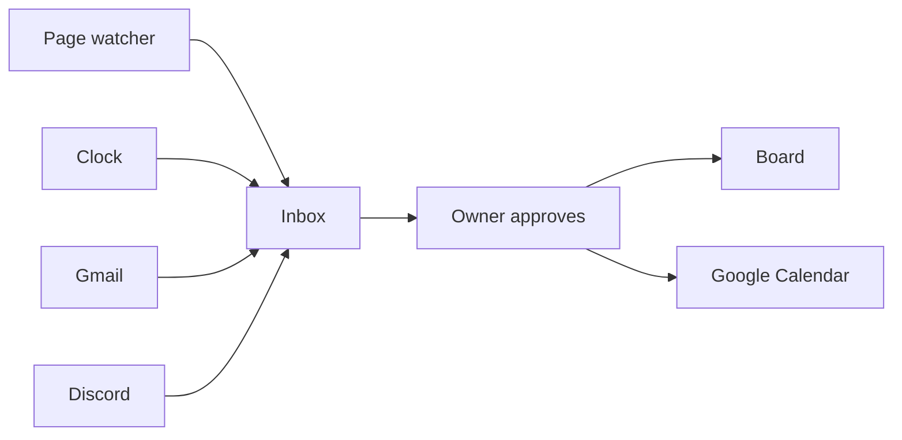
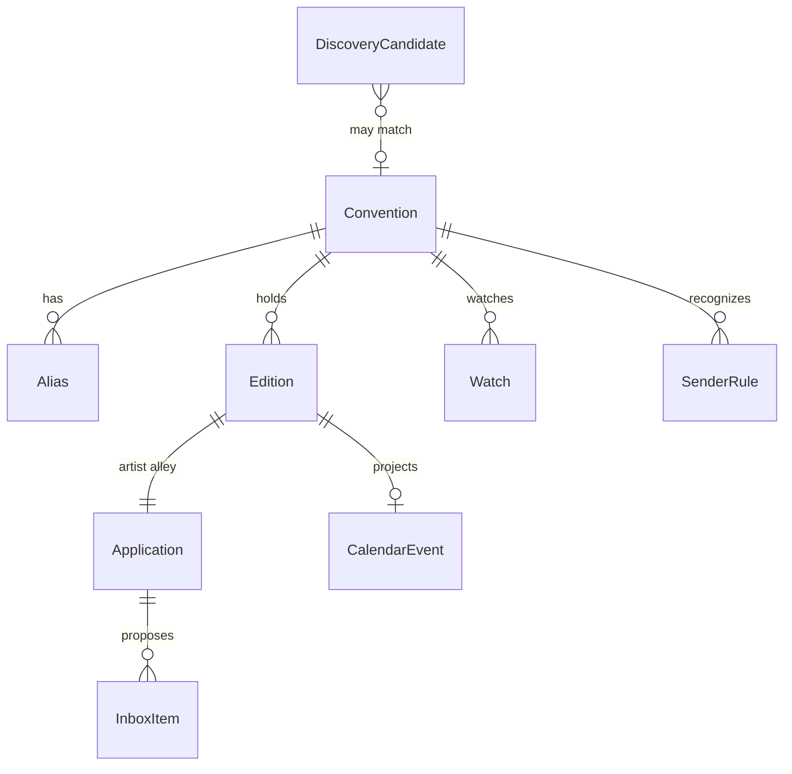
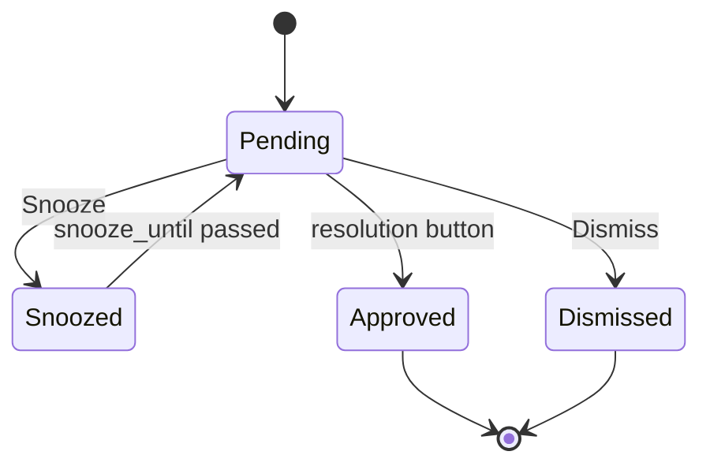

# Expo Tracker design

Local, single-user app for artist-alley applications.

## How to use this document

- Implement the first milestone in the status table whose status is `not started`.
- Read that milestone's section, plus "Locked decisions", "Domain model", and "Inbox".
- Stay inside that milestone. Leave later milestones alone.
- When you finish, mark the row `done` and add a short note (date, what landed, follow-ups).
- Business rules that change the board live in pure functions with unit tests. UI calls those functions. Detectors insert inbox items. They do not update applications.

## Milestone status

| ID | Status | One line |
| --- | --- | --- |
| M0 | done | This design document. |
| M1 | not started | Scaffold the local app, SQLite, and an empty shell. |
| M2 | not started | Manual series, editions, and applications. |
| M3 | not started | Import the Google Sheet, with a review queue. |
| M4 | not started | Inbox and human approval. Seed items by hand. |
| M5 | not started | Google account connection and Calendar projection. |
| M6 | not started | Clock: reminders from approved dates. |
| M7 | not started | Gmail detector for accepted, rejected, waitlisted. |
| M8 | not started | Page watcher: fetch, hash, store a snapshot. |
| M9 | not started | Extract open dates and "open now" into inbox items. |
| M10 | not started | Discord announcements into the same extractor. |
| M11 | not started | AnimeCons discovery, split by drive time from San Mateo. |

## Product

The owner applies to artist alleys at cons that repeat every year. The current tool is a [Google Sheet](https://docs.google.com/spreadsheets/d/1DBenfdO_Q0WZC5pKcRbgCyC94CCDoEyNK9uoJgElK_Q/edit?usp=sharing): one row per edition, with the year baked into the name, mixed status words, and links to sites, forms, Discord, and Gmail.

The app replaces that sheet as the place to edit. The sheet is imported once and then left as an archive. There is no sync back to Google Sheets.

Three things are worth detecting, because each one asks the owner to do something:

1. A con announced an application opening date.
2. Applications are open now.
3. An email says the owner was accepted, rejected, or waitlisted.

Everything else on a card is edited by hand.



## Locked decisions

- **One person.** No accounts, roles, or sharing. The first Google account to connect becomes the owner, unless `OWNER_EMAIL` is set, in which case OAuth must match that address.
- **Artist alley only.** One application per edition. Booth type is `artist_alley`. When a page lists dealer dates and alley dates, the alley date is the one that matters. A generic vendor page is a low-confidence proposal.
- **Local app.** Next.js UI and a worker in one repo, SQLite on disk, run on the owner's machine. Not a hosted multi-user service.
- **Human approval for every change.** Detectors and the clock create inbox items. Status, application dates, and calendar events change only when the owner uses a button on an item. Marking an item read does not approve it.
- **Reminders.** Approved opening dates become all-day Google Calendar events in `America/Los_Angeles`, with a reminder the day before and the morning of. The in-app inbox has read and unread state.
- **Drive range.** "Local" means within 12 hours of driving from San Mateo, CA. The discovery inbox defaults to that range. Farther cons stay in a second list. The owner can track a fly-to con by adding it.
- **Watch list.** Pages and Discord channels are polled only for series the owner is still tracking or applying to. Pass rows are not polled.
- **Discord.** A bot invited to a server, on channel ids the owner configures. A self-bot on the owner's user token is forbidden.
- **Language.** English UI. The sheet's Chinese status words are mapped on import. Display names stay as imported, including Chinese names.

## Out of scope

- Submitting applications automatically.
- Writing status from a scrape or an email without a button press.
- Dealer, exhibitor, or maker-fair workflows.
- Facebook, Instagram, or other social scraping.
- Polling attendance, fees, or table counts.
- Payment tracking. Payment sentences can appear in an email quote. The app does not model "paid" as a detector. The owner can mark an accepted application paid by hand.
- Two-way sync with the Google Sheet.
- A public API, mobile client, or multi-user auth.

## Where it runs

Two entry points, one database:

| Process | Command | Role |
| --- | --- | --- |
| Web UI | `pnpm dev` | Board, inbox, discovery, settings. Port **4747**, bound to `127.0.0.1`. |
| Worker | started with the server, also `pnpm worker` | Gmail poll, page fetch, clock, Discord, discovery. |

The server starts the worker once from Next.js `instrumentation.ts`, guarded by a global so hot reload does not start a second loop. `pnpm worker` runs the same loop for debugging. The worker no-ops any detector whose credentials are missing.

Laptop sleep is expected. Calendar alarms still fire after an event is created. Gmail and page checks catch up the next time the app is running. An always-on `launchd` agent is optional and not part of v1.

```text
data/vendor.sqlite     gitignored database
.env.local             gitignored secrets
drizzle/               committed migrations
```

Stack: TypeScript, Next.js App Router, Tailwind, shadcn/ui, Drizzle, better-sqlite3. Package manager: pnpm. Dates without a time are stored as `YYYY-MM-DD`. The app zone is `America/Los_Angeles`.

## Domain model



### Convention

The stable series. FanimeCon 2026 and FanimeCon 2027 are one convention.

| Field | Notes |
| --- | --- |
| id, display_name, normalized | Display name is preserved. `normalized` is its match key. |
| website | Stable site, not a one-year form URL. |
| polling_enabled | The owner turns this on. Import leaves it off for every convention. |
| notes | Free text. |

A convention has zero or more aliases. FanimeCon 2026 and FanimeCon 2027 share that list. `display_name` stays as written.

### Alias

A name that still differs after the edition identity rules.

| Field | Notes |
| --- | --- |
| id | |
| convention_id | The series this name means. |
| name | As written: `ALA`, `cpac`, `Comic Market`. |
| normalized | Same match key as on a convention. |

`normalized` comes from one function, shared by a convention's display name and every alias. Import, Gmail, and discovery use that function:

- Unicode casefold, and strip Latin diacritics (`Animé` matches `Anime`).
- Drop punctuation and interior space.
- Strip a trailing year and a season word, same as the edition identity rules.
- Keep Chinese characters.

`ALA`, `ala`, and `A.L.A.` all become `ala`. A key that normalizes to empty is rejected. The same `normalized` value cannot appear twice, on a convention or an alias. A collision is a merge proposal, not a second row. The importer proposes it; the owner confirms it in the review queue. Confirmation inserts the alias. So does a name typed on the series page. Changing a display name recomputes that convention's `normalized`. Discovery and detectors only read aliases.

Match an incoming name by normalizing it, then finding the convention or alias with that key. One hit is high confidence. Several hits stay unresolved.

Year and season variants are not aliases. `FanimeCon 26` and `FanimeCon 27` are one series by the identity rules. `cpac` → Castlepoint, `ALA` → Animé Los Angeles, and `Comic Market` → Comiket are aliases. The Comiket cycle numbers stay on the edition.

### Edition

One occurrence. Cycle label examples: `2027`, `2027-winter`, `109` (Comiket).

| Field | Notes |
| --- | --- |
| convention_id, cycle_label | Unique together. |
| start_date, end_date | When the event runs. The sheet often has only a start. End may be null. |
| application_start | Day artist-alley applications open. Null until known. |
| application_end | Day they close. Null until known. |
| application_confirmed | False for an imported window. The clock and Calendar use the application dates only when this is true. |
| calendar_event_id | Google event id for the open-date alarm. Null until created. |
| venue, city, region, country | City is what drive time uses. |
| attendance_text | Kept as text (`27,500`, `1,000+`, `Unknown`). |
| event_status | `announced`, `postponed`, `cancelled`. |

The clock's notices and the calendar reminder are scheduled from `application_start` and `application_end`. An imported window stays unconfirmed and gets a review inbox item instead of a calendar event. The owner confirms it from the inbox or by editing the edition. Only `application_start` becomes a calendar event. `application_end` is shown on the open item and tells the clock when the window ended.

Identity rules for matching a name to a series:

- Strip a trailing year (`2027`, `27`, `26`) and a season word (`Summer`, `Winter`, `Spring`, `Fall`).
- `Comic Market 108` and `Comiket 109` are convention Comiket, cycle `108` or `109`.
- SacAnime Summer and SacAnime Winter are one convention, cycles `2026-summer` and `2027-winter`.

### Application

Exactly one per edition in v1.

| Field | Notes |
| --- | --- |
| booth_type | Always `artist_alley`. |
| intent | `tracking`, `applying`, `skip`. |
| cycle | See vocabulary below. |
| submitted_at, result_at | Dates. |
| skip_reason | `attendance`, `audience`, `travel`, `fee`, `missed`, `other`. |
| notes | The sheet's 注释 column. |
| needs_review | Set by import when a date or status was ambiguous. |

`paid` is a boolean the owner toggles on an accepted card. No detector sets it.

### Watch

Attached to a convention. Kinds: `html`, `eventeny`, `eventhub`, `google_form`, `discord_channel`.

Fields: target URL or Discord channel id, `last_hash`, `last_fetched_at`, `last_error`. Polling runs only when `polling_enabled` is true and the latest edition's intent is `tracking` or `applying` and its cycle is not `rejected`, `withdrawn`, or left as a skip.

### Inbox item

| Field | Notes |
| --- | --- |
| kind | `opening_date`, `applications_open`, `decision`, `notice`. |
| dedupe_key | See below. |
| proposal_json | Dates, or `accepted` / `rejected` / `waitlisted`, or notice text. |
| evidence_quote, evidence_url | What the owner reads before approving. |
| confidence | `high` or `low`. |
| state | `pending`, `snoozed`, `approved`, `dismissed`. Notices only use read state. |
| snooze_until | Hidden until this instant. |
| read_at | Null means unread. Independent of `state`. |
| created_at, resolved_at | |

Dedupe keys:

| Kind | Key | On a repeat |
| --- | --- | --- |
| `opening_date` | `edition_id + opening_date` | Update quote, dates, and confidence in place if still pending. |
| `applications_open` | `edition_id + applications_open` | Leave the pending item. Do not file a second one. |
| `decision` | Gmail message id | Ignore the duplicate. |
| `notice` | `edition_id + notice kind + local date` | Ignore the duplicate. |

### Other tables

- `sender_rule`: email domain → convention id, created when the owner assigns an ambiguous message.
- `snapshot`: watch id, fetched_at, content hash, extracted text. Keep the latest few per watch.
- `discovery_candidate`: external id, name, dates, city, drive minutes, state `new` / `tracked` / `ignored`.
- `drive_time`: city key → minutes, miles, source (`seed` or `override`).
- `google_credential`: single row, refresh token, scopes.
- `setting`: owner email, timezone, drive-limit hours (default 12), calendar id.

## Status vocabulary

Intent and cycle are separate. The board column is the cycle, except `intent = skip`, which is the Pass column.

| Cycle | Meaning | Board column |
| --- | --- | --- |
| `unknown` | No application state yet. | Tracking, if intent is tracking. |
| `not_open` | Watching, window not open. | Tracking |
| `open` | Window is open, owner has not submitted. | Tracking, with an Open badge |
| `submitted` | Owner applied. | Applied |
| `waitlisted` | | Waitlist |
| `accepted` | | Accepted |
| `rejected` | | Rejected |
| `withdrawn` | Owner backed out. | A filter, not a primary column. |

Sheet words on import:

| Sheet 状态 | intent | cycle |
| --- | --- | --- |
| 留意中 | tracking | `not_open` if an open date is in the future, else `unknown` |
| 已申请 | applying | `submitted` |
| Waitlist | applying | `waitlisted` |
| 已通过 | applying | `accepted` |
| 已拒绝 | applying | `rejected` |
| Pass | skip | `unknown`. Skip reason from the note when it mentions attendance, travel, fee, or audience (偏美漫 → `audience`). |
| 申请已结束 | tracking | leave cycle `unknown`, `needs_review` true. Do not guess `missed`. |

`申请日期` heuristic, always shown in the review queue when `needs_review` is set:

| Situation | Proposal |
| --- | --- |
| Result date present, and cycle is submitted, waitlisted, accepted, or rejected | `申请日期` is `submitted_at`. Result date is `result_at`. |
| 留意中, date present | `申请日期` is an unconfirmed `application_start`. |
| 申请已结束, date present, note contains a range such as `9/12 - 9/20` | Propose open and close from the note. |
| Anything else with a date | Unresolved date. Do not attach it to submitted_at or the application dates until the owner picks. |

Examples from the sheet:

- FanimeCon 27, 留意中, 11/08/2026, note 限时申请 → `application_start` 2026-11-08, unconfirmed, intent tracking.
- SacAnime Summer 26, 已拒绝, 申请日期 6/5/2026, 申请结果 6/17/2026 → submitted 2026-06-05, result 2026-06-17, cycle rejected.
- Zenkaikon, 申请已结束, date 2026-09-12, note `AA申请 9/12 - 9/20` → propose open 2026-09-12 and close 2026-09-20, needs review.
- SJ Made Winter Wonder Market, 已通过 → cycle accepted. Same for other San José Made markets, under one convention "San José Made".

Series merges the importer should propose, not apply silently: FanimeCon 26 with 27, SacAnime Summer with Winter, Comic Market 108 with 109. Those already collapse under the identity rules, so confirming one does not insert an alias. A name that stays different, such as `cpac` for Castlepoint, is proposed as an alias and inserted only when the owner confirms it.

## Inbox and approval

Read means the owner opened the item. Pending means the board is unchanged.



Buttons and the only writes they may perform:

| Kind | Buttons | Writes |
| --- | --- | --- |
| `opening_date` | Save date, Save with edits, Dismiss, Snooze | Set `application_start` and, if present, `application_end`. Set `application_confirmed`. Sync Calendar for the open date. Leave intent and cycle alone. |
| `applications_open` | I submitted, Skip, Snooze | Submitted sets intent `applying`, cycle `submitted`, `submitted_at` today. Skip sets intent `skip`. |
| `decision` | Apply this result, Wrong con, Dismiss, Snooze | Apply sets cycle to the proposed `accepted`, `rejected`, or `waitlisted`, and `result_at` from the message date. Wrong con clears the guess and asks for an edition; on pick, store a sender rule. |
| `notice` | Mark read | Sets `read_at` only. |

`applications_open` stays pending until one of those buttons. That persistent item is the nag while a window is open.

A close date in the past, with no submission, resolves the pending `applications_open` item and files a `notice`: "Window ended". It does not change cycle.

Low confidence still files the item. The UI shows the quote and an Unconfirmed label. Save is still required.

All of this goes through one function, `resolveInboxItem(db, item, resolution)`, covered by unit tests. The UI and the tests call that function. Detectors call `upsertInboxItem`.

## Detectors

### Clock (M6)

Runs every few minutes locally. Uses an edition only when `application_confirmed` is true.

- On the Pacific morning of `application_start`, ensure one `notice` for that edition and date: "Artist alley applications open today", linking the form or site.
- Seven days before a confirmed `application_start`, ensure one notice.
- On the morning of `application_end`, if cycle is still tracking or `open`, resolve `applications_open` if present and file "Window ended".
- If today is on or after a confirmed `application_start`, before `application_end`, and cycle is not submitted or terminal, ensure one `applications_open` item.

The clock does not fetch pages.

### Gmail (M7)

Read-only. Poll about every three minutes while the worker runs. Use the history API after the first sync, and store `history_id`.

Consider a message only when it is newer than the edition was created and the matching application is `submitted` or `waitlisted`.

Classification labels: `accepted`, `rejected`, `waitlisted`, `acknowledgement`, `other`.

- The first three file a `decision` item with a short quote and the Gmail link.
- Acknowledgement ("we received your application") files nothing.
- Match order: a known sender domain for that convention, then the convention name or an alias in the subject or body, using the alias function.
- If several applications could fit, file the item with edition unset and the Wrong-con / pick-edition control. Do not guess.

Store the Gmail message id, thread id, and a short quote. Do not store the whole mailbox.

### Page watcher (M8, M9)

For each due watch: conditional fetch, hash the visible text, stop if the hash matches. Store a snapshot when it changes.

Cadence: every 24 hours when the edition has no open date, or the open date is within 14 days, or a pending `applications_open` item exists. Otherwise every 7 days.

M9 runs only on a new hash, or on a manual "Check now".

Rule parsers, no model required:

- **Eventeny / EventHub.** Read the stable apply-versus-closed state. `open_now` true or false.
- **Google Form.** The "not accepting responses" page means closed. A live form means `open_now` true. Forms do not yield a reliable open date.

Prose on an `html` watch uses one function, `extractApplicationWindow(text, context) -> { open_date, close_date, open_now, evidence_quote, confidence }`.

Provider is configuration, not a hardcoded vendor: `LLM_BASE_URL`, `LLM_API_KEY`, `LLM_MODEL`. The context passed in is the convention name, the edition cycle, and the event start date. If `LLM_API_KEY` is empty, skip prose extraction and file nothing from that page. The snapshot is still stored. Rule parsers work without a key.

After extraction, a checker downgrades confidence to low when:

- `open_date` is after the edition `start_date`.
- `close_date` is before `open_date`.
- The open date year is not the event year and not the previous year.
- The quote has no artist-alley wording and the page looks like a generic vendor application.

`open_now` true files or refreshes `applications_open`. A new or changed date files or refreshes `opening_date`. A hash change with no extracted date files nothing.

### Discord (M10)

Same extractor and the same inbox kinds as a page. The bot listens to `MESSAGE_CREATE` on configured channel ids. Message Content intent is required.

Servers that refuse bots are covered by a private forward channel in a server the owner controls: forwarded text goes through the same classifier.

The SacAnime cell in the sheet is already a guild, channel, and message URL (`discord.com/channels/...`). A watch stores guild id and channel id.

### What a quiet week means

Each tracking card lists its watches. A convention with none shows "No automatic source", so silence is not mistaken for "nothing was announced".

Image-only announcements, Facebook, and Instagram are invisible to these detectors.

## Calendar

On approval of an open date:

- Create an all-day event on the connected calendar.
- Title: `{Convention} {cycle} artist alley opens`.
- Time zone `America/Los_Angeles`.
- Reminders: one day before, and morning-of (09:00 local).
- Store the Google event id on the edition.

Approving a corrected date patches that event. Dismissing a proposal leaves the event alone. Clearing `application_start` in the UI deletes the event.

Scope: `https://www.googleapis.com/auth/calendar.events`. The app only patches event ids it stored.

Notices for "opens today" are in-app. The calendar event is the alarm that works when the laptop is shut.

## Discovery and drive time

M

11. A weekly fetch of AnimeCons.com's US schedule for the current and next year. Cache the raw body in `snapshot`. User-Agent identifies a personal tracker. Slow and infrequent. Do not publish the scraped list.

Each row becomes a `discovery_candidate` matched against conventions:

- Normalize the name with the alias function.
- High confidence if that key hits one convention or alias. Attach as a new edition only after the owner presses Track.
- Otherwise leave it unmatched.

Drive time is city-level, cached, from San Mateo. v1 ships a seed table and an override field on the candidate. Unknown cities show as "drive time unknown" in the Farther list. Do not call a paid routing API.

Seed these planning estimates so the default split is sane (nonstop hours from San Mateo):

| City | Hours | Default list |
| --- | --- | --- |
| San Jose, San Francisco, Sacramento | under 2 | Within a day |
| Los Angeles, Pasadena, Long Beach, Anaheim | about 6 | Within a day |
| San Diego | about 8 to 9 | Within a day |
| Las Vegas | about 8.5 | Within a day |
| Portland | about 10 | Within a day |
| Phoenix | about 13 | Farther |
| Salt Lake City | about 13 | Farther |
| Seattle | about 13 to 14 | Farther |

The card shows the hours. The cutoff is the `drive_limit_hours` setting, default 12. Track creates the edition and an artist-alley application with intent `tracking`, and copies the con's website onto a watch if one was found.

AnimeCons does not say whether a con has an artist alley. The owner decides by tracking it.

## Google OAuth

Personal Cloud project, consent screen in **Testing**, owner added as a test user. That is enough for `gmail.readonly`, which is a restricted scope. Do not publish the app for verification.

- Web client, redirect `http://127.0.0.1:4747/api/google/callback`.
- Scopes: `openid`, `email`, `https://www.googleapis.com/auth/gmail.readonly`, `https://www.googleapis.com/auth/calendar.events`.
- `access_type=offline` and `prompt=consent` on first connect, so a refresh token is returned.
- Client id and secret live in `.env.local`. Tokens live in `google_credential`.
- Manual tracking, import, and the inbox work with no Google connection. Settings shows a clear disconnected state. Gmail and Calendar buttons explain what is missing.

## Module map

Keep these boundaries. A milestone may add files only in the modules it names.

| Module | Responsibility |
| --- | --- |
| `src/db` | Drizzle client, migrations, SQLite path `data/vendor.sqlite`. |
| `src/domain` | Types, status transitions, `resolveInboxItem`, `upsertInboxItem`, edition naming, alias normalization. No I/O beyond the db passed in. |
| `src/import` | Sheet CSV parse, heuristics, review decisions. |
| `src/inbox` | Queries for pending, unread, snooze wakeups. |
| `src/google` | OAuth, token refresh, Calendar create/patch/delete, Gmail list/get. |
| `src/detectors/clock.ts` | Date-based inbox items. |
| `src/detectors/gmail.ts` | Decision classification and matching. |
| `src/detectors/page.ts` | Fetch, hash, rule parsers. |
| `src/detectors/extract.ts` | `extractApplicationWindow`. |
| `src/detectors/discord.ts` | Bot gateway. |
| `src/discovery` | AnimeCons fetch, name match, drive-time seed. |
| `src/worker` | Loop and intervals. No detection logic of its own. |
| `src/app` | Routes and UI. Calls domain functions. |

UI routes:

| Path | Milestone | Purpose |
| --- | --- | --- |
| `/` | M2 | Board: Tracking, Applied, Waitlist, Accepted, Rejected, Pass. |
| `/series/[id]` | M2 | Aliases, editions across years, application dates, watches, notes. |
| `/import` | M3 | Review ambiguous rows and proposed merges. |
| `/inbox` | M4 | Unread and pending. Read is not approval. |
| `/discover` | M11 | Within a day, and Farther. |
| `/settings` | M5 | Google connection, owner, drive-limit hours. Watches are edited on the series page. |

Desktop layout first. The board should still be usable at a narrow width. No separate mobile design.

Empty states are real copy: no conventions yet (point at import or add), inbox clear, Google not connected, no watches on a series.

## Environment

M1 adds `.env.example` with:

```text
OWNER_EMAIL=
SESSION_SECRET=
GOOGLE_CLIENT_ID=
GOOGLE_CLIENT_SECRET=
GOOGLE_REDIRECT_URI=http://127.0.0.1:4747/api/google/callback
LLM_BASE_URL=
LLM_API_KEY=
LLM_MODEL=
DISCORD_BOT_TOKEN=
```

`SESSION_SECRET` signs the local session cookie. The app is still usable before any of the optional keys exist.

## Milestones

Each milestone ends with tests or a manual pass as listed. Update the status table in the same commit.

### M1 — Scaffold

Create the Next.js app in this repo (scaffold into a subdirectory, then move files up; do not target the filesystem root). Tailwind, shadcn/ui, Drizzle, better-sqlite3. Port 4747 on `127.0.0.1`. Database file created on first launch. A home page that states the app is the artist-alley tracker and links to the design doc's purpose in a sentence of real copy. `.env.example` and a README run section that matches reality.

Done when `pnpm dev` serves the home page and a second launch reuses the same SQLite file.

Do not build the board, OAuth, or detectors.

### M2 — Manual model

Migrations for convention, alias, edition, and application. UI to create and edit them, including the application dates, the Pass / skip reason, and the paid toggle. Series page shows that convention's aliases and its editions in cycle order. Board groups applications into the columns above.

Done when you can add FanimeCon, a 2027 edition, an application start of 2026-11-08, and see it on the board under Tracking, then mark it skipped and see it under Pass.

Domain writes go through `src/domain`. Cover cycle and intent changes with unit tests.

Do not import the sheet. Do not add inbox items yet.

### M3 — Sheet import

Fetch the public CSV for spreadsheet `1DBenfdO_Q0WZC5pKcRbgCyC94CCDoEyNK9uoJgElK_Q` (the 摆摊 sheet) or accept a downloaded CSV at `data/sheet.csv`. Apply the vocabulary and date heuristic. Proposed series merges, proposed aliases, and every `needs_review` row appear on `/import` until accepted or edited. Import leaves `polling_enabled` off on every convention, including maker-fair rows such as San José Made. The owner turns polling on. Re-running import is idempotent: match on a stored sheet-row key, do not duplicate conventions.

Done when a fresh database import reproduces Fanime as one series with two editions, SacAnime as one series, Comiket as one series, and Zenkaikon sitting in the review queue. Unit tests cover the heuristic table, including the three examples in this doc.

Do not poll URLs during import.

### M4 — Inbox and approval

Tables and `resolveInboxItem` / `upsertInboxItem`. `/inbox` with unread styling, snooze, and the buttons in the approval table. A developer-only way to insert a sample item of each kind (a button on the inbox empty state is enough) so the loop can be tested without Gmail.

Done when: saving a sample open date sets a confirmed `application_start` and does not change cycle; "I submitted" moves the card to Applied; "Apply this result" moves it to Accepted or Rejected; Dismiss changes nothing; marking read leaves it pending. Unit tests cover each resolution.

`resolveInboxItem` calls `syncApplicationStart(edition)` after it confirms an open date. In this milestone that function is a no-op. M5 fills in the Calendar call. Do not import Google here.

Do not call Google, Discord, or the network.

### M5 — Google Calendar

OAuth as specified. Settings page shows connected email or the disconnected state. Replace the M4 no-op `syncApplicationStart` so approving an `opening_date` item creates the all-day event and stores the id on the edition. Approving a new date for the same edition patches it. Disconnect leaves local data in place and stops Calendar calls.

Done when the flow works against a real test user if credentials are present, and when they are absent the rest of the app still runs and Settings explains how to connect. Calendar calls sit behind `src/google` so tests can use a fake.

Do not read Gmail yet.

### M6 — Clock

`src/detectors/clock.ts` plus the worker interval. Notices and `applications_open` items follow the clock rules. "Window ended" resolves the open item and files a notice.

Done when unit tests freeze the Pacific calendar date and cover: seven days before, morning of, already submitted (no nag), and the day after close with no submission.

Do not fetch pages.

### M7 — Gmail decisions

History sync, classifier, sender rules, `decision` inbox items. Classifier can be a small set of bilingual patterns plus the LLM function when a key is present. Patterns must treat "application received" as acknowledgement.

Done when fixture messages for accepted, rejected, waitlisted, and acknowledgement produce the right inbox result, an ambiguous sender files an item with no edition, and picking the edition stores a sender rule. No test hits the live Gmail API.

Do not auto-apply the result.

### M8 — Page fetch

Watch CRUD on the series page. Worker fetches due watches, stores snapshots, records errors on the watch. "Check now" runs one watch. Hash match does not insert a new snapshot body.

Done when a local fixture HTTP server (or a recorded HTML file loaded through the same hash function) proves a second identical fetch is a no-op and a changed body stores a new snapshot. The UI shows last fetch time and last error.

Do not extract dates yet. Do not file inbox items from page text.

### M9 — Extraction

Eventeny, EventHub, and Google Form parsers. `extractApplicationWindow` behind the LLM config. The date checker. Filing `opening_date` and `applications_open` items through `upsertInboxItem`.

Done when fixture HTML for an Eventeny-style open page, a closed Google Form, and a prose page with an alley date each produce the expected item or the expected silence. A prose page with only an event start date does not file an opening date. Low-confidence results are labeled and still require Save.

### M10 — Discord

Bot started by the worker when `DISCORD_BOT_TOKEN` is set. Series page can attach a channel id. Messages on that channel go through `extractApplicationWindow`. A second channel id in settings is the personal forward inbox.

Done when a fixture message object ("Artist alley opens November 8") files the same shape of item as a page extract. With the token unset, the worker logs one line and continues. Document the developer-portal steps (bot, Message Content intent, invite URL) in the README.

No self-bot. No listening to every channel in a guild.

### M11 — Discovery

Weekly AnimeCons US fetch for this year and next year, name matching, seed drive times, `/discover` with the two lists, Track and Ignore. Track creates edition plus tracking application plus an `html` watch when a site URL exists.

Done when a fixture schedule containing Fanime (already in the db) and a brand-new Bay Area con produces one "new edition" suggestion and one new candidate under Within a day, and a New York con lands under Farther. Ignore stays ignored on the next run.

## Testing

- Domain and detector milestones: unit tests for the cases named in the milestone. Run them with `pnpm test`.
- UI milestones (M2 onward): exercise the path in a browser on port 4747. Click through create, import review, inbox resolutions, and settings. Say what you clicked and what you saw in the milestone note.
- External services stay behind fixtures. Live Google is optional and only when `.env.local` is present.

## Sheet reference

Public sheet, title 摆摊:

`https://docs.google.com/spreadsheets/d/1DBenfdO_Q0WZC5pKcRbgCyC94CCDoEyNK9uoJgElK_Q`

Columns: 名称, 地点, 开展日期, 申请日期, 申请结果, 状态, 预计总人流, 官方网页, 其他连接, 注释.

Links in 其他连接 are typed into watches when the owner later enables polling, not during the first import automatic pass, except that the importer may store them as untyped links on the edition for the owner to promote. Discord, Gmail, Google Forms, Eventeny, and EventHub URLs should be recognizable so the review UI can offer "Add as watch" as a separate action. That promote-to-watch action can land in M8, not M3.
