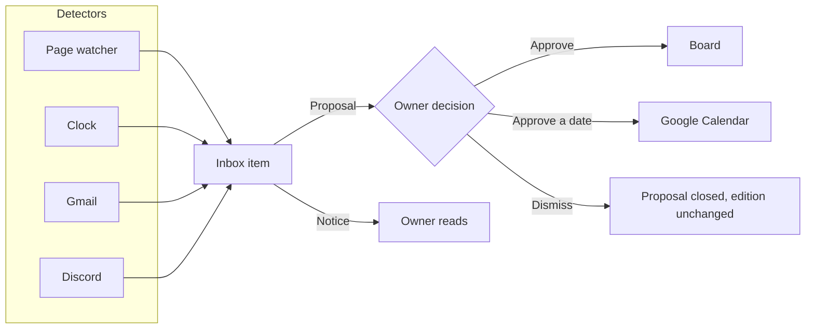
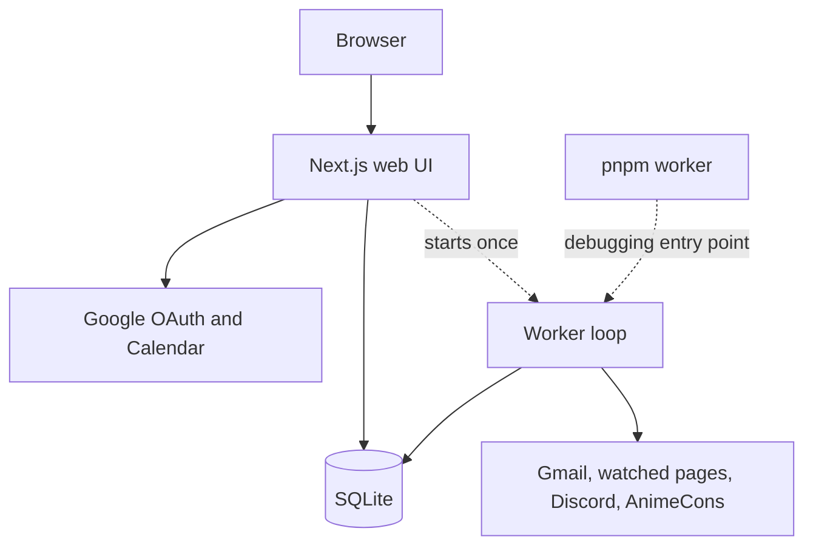
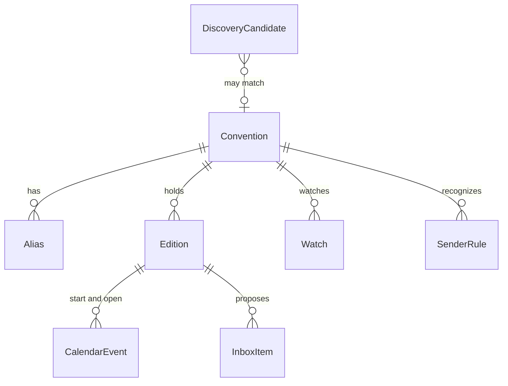
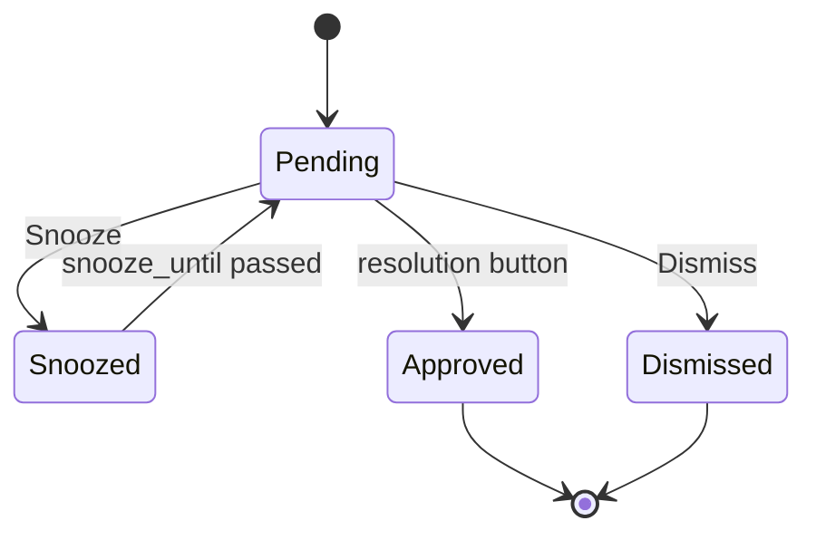

# Expo Tracker design

Expo Tracker is a local, single-user app for managing artist-alley applications.

## How to use this document

1. Find the first milestone marked `not started` in the status table.
2. Read that milestone's section, plus [Locked decisions](#locked-decisions), [Domain model](#domain-model), and [Inbox and approval](#inbox-and-approval).
3. Implement only that milestone. Do not start later milestones.
4. When finished, mark the milestone `done` and add one dated note describing what landed and what the next agent should know.

Rules for every milestone:

- Put board-changing business rules in pure functions with unit tests.
- The UI calls those functions.
- Detectors may create inbox items, but they never change an edition's status directly.

## Milestone status

| ID | Status | One line |
| --- | --- | --- |
| M0 | done | This design document. |
| M1 | done | Scaffold the local app, SQLite, and an empty shell. |
| M2 | done | Manual series and editions. |
| M3 | done | Import the Google Sheet, with a review queue. |
| M4 | not started | Inbox and human approval. Seed items by hand. |
| M5 | not started | Google account connection and Calendar projection. |
| M6 | not started | Clock: reminders from approved dates. |
| M7 | not started | Gmail detector for accepted, rejected, waitlisted. |
| M8 | not started | Page watcher: fetch, hash, store a snapshot. |
| M9 | not started | Extract open dates and "open now" into inbox items. |
| M10 | not started | Discord announcements into the same extractor. |
| M11 | not started | AnimeCons discovery, split by drive time from San Mateo. |

## Reading map

- **Product rules:** [Product](#product), [Locked decisions](#locked-decisions), and [Out of scope](#out-of-scope).
- **Data and behavior:** [Domain model](#domain-model), [Status vocabulary](#status-vocabulary), and [Inbox and approval](#inbox-and-approval).
- **Automation:** [Detectors](#detectors), [Calendar](#calendar), [Discovery and drive time](#discovery-and-drive-time), and [Google OAuth](#google-oauth).
- **Implementation:** [Module map](#module-map), [Environment](#environment), [Milestones](#milestones), and [Testing](#testing).

## Product

### Problem

The owner applies to artist alleys at conventions that repeat every year. The current tool is a [Google Sheet](https://docs.google.com/spreadsheets/d/1DBenfdO_Q0WZC5pKcRbgCyC94CCDoEyNK9uoJgElK_Q/edit?usp=sharing) with:

- one row per convention edition;
- the year embedded in the convention name;
- inconsistent status terms; and
- links mixed across websites, application forms, Discord, and Gmail.

The app replaces that sheet as the place to edit. The sheet is imported once and then left as an archive. There is no sync back to Google Sheets.

### What the app detects

Automation looks for only three actionable signals:

1. A con announced an application opening date.
2. Applications are open now.
3. An email says the owner was accepted, rejected, or waitlisted.

Everything else on a card is edited manually.

### Approval model

All automated signals become inbox items. Proposals require an owner decision; notices only need to be read. Only the owner can turn a proposal into a board or calendar change.



## Locked decisions

These choices are settled and should not be reopened during implementation.

### Scope and ownership

- **Single owner:** No accounts, roles, or sharing. The first connected Google account becomes the owner. If `OWNER_EMAIL` is set, OAuth must match it.
- **Artist alley only:** An edition represents the owner's artist-alley application for one occurrence. If a page lists both dealer and artist-alley dates, use the artist-alley dates. Treat a generic vendor page as low confidence.
- **English UI, preserved names:** Map Chinese sheet statuses during import, but preserve imported display names, including Chinese names.

### Runtime and automation

- **Local app:** Run a Next.js UI and a worker from one repository, with SQLite on the owner's machine. This is not a hosted multi-user service.
- **Human approval:** Detectors and the clock create inbox items. Statuses, application dates, and calendar events change only after the owner presses a resolution button. Marking an item read is not approval.
- **Watch only active series:** Poll pages and Discord channels only while the owner is tracking or applying to a series. Never poll passed rows.
- **Discord bot only:** Use an invited bot on explicitly configured channel IDs. Never use a self-bot or the owner's user token.

### Reminders and discovery

- **Calendar reminders:** A saved convention start date and a confirmed application open date each create an all-day Google Calendar event in `America/Los_Angeles`. Each event reminds the owner the day before and the morning of.
- **Inbox indicators:** Inbox items have independent read and resolution states.
- **Drive range:** "Local" means at most 12 hours of driving from San Mateo, CA. Discovery defaults to that range and puts farther conventions in a second list. The owner may still track a fly-to convention.

## Out of scope

- Submitting applications automatically.
- Writing status from a scrape or an email without a button press.
- Dealer, exhibitor, or maker-fair workflows.
- Facebook, Instagram, or other social scraping.
- Polling attendance, fees, or table counts.
- Payment tracking. Payment sentences can appear in an email quote. The app does not model "paid" as a detector. The owner can mark an accepted application paid by hand.
- Two-way sync with the Google Sheet.
- A public API, mobile client, or multi-user auth.

## Where it runs

Two entry points, one database:

| Process | Command | Role |
| --- | --- | --- |
| Web UI | `pnpm dev` | Board, inbox, discovery, settings. Port **4747**, bound to `127.0.0.1`. |
| Worker | started with the server, also `pnpm worker` | Gmail poll, page fetch, clock, Discord, discovery. |



The server starts the worker once from Next.js `instrumentation.ts`. A global guard prevents hot reload from starting a second loop. `pnpm worker` runs the same loop for debugging. A detector with missing credentials simply does no work.

Laptop sleep is expected. Calendar alarms still fire after an event is created. Gmail and page checks catch up the next time the app is running. An always-on `launchd` agent is optional and not part of v1.

### Local files

```text
data/vendor.sqlite     gitignored database
.env.local             gitignored secrets
drizzle/               committed migrations
```

### Stack and date rules

- **Stack:** TypeScript, Next.js App Router, Tailwind, shadcn/ui, Drizzle, and better-sqlite3.
- **Package manager:** pnpm.
- **Date-only format:** `YYYY-MM-DD`.
- **Application time zone:** `America/Los_Angeles`.

## Domain model

The core hierarchy is:

- A **convention** is the stable series, such as FanimeCon.
- An **edition** is one occurrence of that series, such as FanimeCon 2027.
- An **alias** is another name for the same series, such as `ALA` for Animé Los Angeles.
- A **watch** is an automated source associated with a convention.
- An **inbox item** is a proposed change or notice. It usually belongs to an edition, but an ambiguous Gmail decision may remain unassigned until the owner resolves it.



### Convention

The stable series. For example, FanimeCon 2026 and FanimeCon 2027 belong to one convention.

| Field | Notes |
| --- | --- |
| id, display_name, normalized | Display name is preserved. `normalized` is its match key. |
| website | Stable site, not a one-year form URL. |
| polling_enabled | The owner turns this on. Import leaves it off for every convention. |
| notes | Free text. |

A convention has zero or more aliases, shared by every edition. Its `display_name` is always preserved as written.

### Alias

Another name for a convention that remains different after applying the edition identity rules.

| Field | Notes |
| --- | --- |
| id | |
| convention_id | The series this name means. |
| name | As written: `ALA`, `cpac`, `Comic Market`. |
| normalized | Same match key as on a convention. |

#### Normalization

One function computes `normalized` for both convention display names and aliases. Import, Gmail, and discovery all use it:

- Unicode casefold and strip Latin diacritics, so `Animé` matches `Anime`.
- Remove punctuation and interior spaces.
- Remove a trailing year and season word, using the edition identity rules below.
- Preserve Chinese characters.

For example, `ALA`, `ala`, and `A.L.A.` all normalize to `ala`.

#### Constraints and matching

- Reject a key that normalizes to an empty string.
- A `normalized` value must be unique across conventions and aliases.
- Treat a collision as a merge proposal, not a second row. The importer proposes the merge and the owner confirms it in the review queue.
- Confirmation inserts the alias. A name entered on the series page also inserts an alias.
- Changing a convention's display name recomputes its `normalized` key.
- Discovery and detectors may read aliases but never create them.

To match an incoming name, normalize it and look for that key on conventions and aliases. One match is high confidence. Multiple matches remain unresolved.

Year and season variants are not aliases:

- `FanimeCon 26` and `FanimeCon 27` are one series under the edition identity rules.
- `cpac` → Castlepoint, `ALA` → Animé Los Angeles, and `Comic Market` → Comiket are aliases. Those aliases are confirmed by the owner; the name function does not hard-code them.
- Trailing cycle numbers such as Comiket `109` remain on the edition.

### Edition

One occurrence of a convention. Example cycle labels are `2027`, `2027-winter`, and `109` for Comiket.

| Field | Notes |
| --- | --- |
| convention_id, cycle_label | Unique together. |
| start_date, end_date | When the event runs. The sheet often has only a start. End may be null. |
| application_start_date | Day artist-alley applications open. Null until known. |
| application_end_date | Day they close. Null until known. |
| application_confirmed | False for an imported window. The clock and the open-date calendar event use the application dates only when this is true. |
| start_date_calendar_event_id | Google event id for `start_date`. Null until created. |
| application_start_date_calendar_event_id | Google event id for a confirmed `application_start_date`. Null until created. |
| venue, city, region, country | City is what drive time uses. |
| attendance | Integer expected attendance. Null when unknown. Import strips commas and a trailing plus: `27,500` is 27500, `1,000+` is 1000, `Unknown` is null. |
| intent | `tracking`, `applying`, or `skip`. |
| status | See the status vocabulary. |
| submitted_at, result_at | Dates. Either may be null. |
| paid | The owner toggles this on an accepted card. No detector sets it. |
| notes | The sheet's 注释 column. A reason for skipping goes here. |

#### Date behavior

- The clock schedules notices from `application_start_date` and `application_end_date`.
- The calendar gets an all-day event for `start_date`.
- The calendar also gets an all-day event for `application_start_date`, but only when `application_confirmed` is true.
- An imported application window remains unconfirmed. It creates a review inbox item instead of a calendar event.
- The owner confirms an imported window from the inbox or by editing the edition.
- `application_end_date` appears on the open item and tells the clock when the window has ended.
- `end_date` and `application_end_date` never create calendar events.
- Import writes dates but leaves both calendar event IDs null.

#### Edition identity

- Strip a trailing year (`2027`, `27`, `26`), a season word (`Summer`, `Winter`, `Spring`, `Fall`), or another trailing cycle number (`108`, `109`).
- `Comic Market 108` and `Comic Market 109` are one series, cycles `108` and `109`. `Comiket 109` is a different series until the owner adds `Comic Market` as an alias.
- SacAnime Summer and SacAnime Winter are one convention, cycles `2026-summer` and `2027-winter`.
- SJ Made events at different times of year are separate series. `SJ Made Winter Wonder Market` and `SJMade Fest` do not merge. `Winter Wonder Market 2026` and `Winter Wonder Market 2027` are editions of the same series.

### Watch

A watch is an automated source attached to a convention.

| Field | Notes |
| --- | --- |
| kind | `html`, `eventeny`, `eventhub`, `google_form`, or `discord_channel`. |
| target | URL or Discord channel ID. |
| last_hash | Hash from the most recent successful content fetch. |
| last_fetched_at | Most recent fetch time. |
| last_error | Most recent fetch error. |

Poll only when all of the following are true:

1. The convention has `polling_enabled` set to true.
2. Its latest edition has intent `tracking` or `applying`.
3. That edition's status is not `rejected`, `withdrawn`, `attended`, or `passed`.

### Inbox item

| Field | Notes |
| --- | --- |
| kind | `opening_date`, `applications_open`, `decision`, `notice`. |
| dedupe_key | See below. |
| proposal_json | Dates, or `accepted` / `rejected` / `waitlisted`, or notice text. |
| evidence_quote, evidence_url | What the owner reads before approving. |
| confidence | `high` or `low`. |
| state | `pending`, `snoozed`, `approved`, `dismissed`. Notices only use read state. |
| snooze_until | Hidden until this instant. |
| read_at | Null means unread. Independent of `state`. |
| created_at, resolved_at | |

#### Dedupe keys

| Kind | Key | On a repeat |
| --- | --- | --- |
| `opening_date` | `edition_id + opening_date` | Update quote, dates, and confidence in place if still pending. |
| `applications_open` | `edition_id + applications_open` | Leave the pending item. Do not file a second one. |
| `decision` | Gmail message id | Ignore the duplicate. |
| `notice` | `edition_id + notice kind + local date` | Ignore the duplicate. |

### Other tables

- `sender_rule`: email domain → convention id, created when the owner assigns an ambiguous message.
- `snapshot`: watch id, fetched_at, content hash, extracted text. Keep the latest few per watch.
- `discovery_candidate`: external id, name, dates, city, drive minutes, state `new` / `tracked` / `ignored`.
- `drive_time`: city key → minutes, miles, source (`seed` or `override`).
- `google_credential`: single row, refresh token, scopes.
- `setting`: owner email, timezone, drive-limit hours (default 12), calendar id.

## Status vocabulary

Intent and status answer different questions:

- **Intent:** What does the owner plan to do? Values are `tracking`, `applying`, and `skip`.
- **Status:** Where is the application in its lifecycle? Status determines the board column.

| Status | Meaning | Board column |
| --- | --- | --- |
| `unknown` | No application state yet. | Tracking, if intent is tracking. |
| `not_open` | Watching, window not open. | Tracking |
| `open` | Window is open, owner has not submitted. | Tracking, with an Open badge |
| `submitted` | Owner applied. | Applied |
| `waitlisted` | The owner is on the waitlist. | Waitlist |
| `accepted` | The application was accepted. | Accepted |
| `attended` | Owner went. Set by hand. No detector sets it. | Attended |
| `rejected` | The application was rejected. | Rejected |
| `withdrawn` | Owner backed out. | A filter, not a primary column. |
| `passed` | Owner decided not to apply. | Pass |

### Import status mapping

Map sheet statuses as follows:

| Sheet 状态 | intent | status |
| --- | --- | --- |
| 留意中 | tracking | `not_open` if an open date is in the future, else `unknown` |
| 已申请 | applying | `submitted` |
| Waitlist | applying | `waitlisted` |
| 已通过 | applying | `accepted` |
| 已拒绝 | applying | `rejected` |
| Pass | skip | `passed`. The note is stored in `notes`. |
| 申请已结束 | tracking | `unknown`. Do not guess that the owner missed it. The row stays in the review queue. |

### Import date heuristic

Interpret `申请日期` using the first matching rule below. Keep unresolved dates and ended windows on `/import` until the owner accepts or edits them.

| Situation | Proposal |
| --- | --- |
| Result date present, and status is submitted, waitlisted, accepted, attended, or rejected | `申请日期` is `submitted_at`. Result date is `result_at`. |
| 留意中, date present | `申请日期` is an unconfirmed `application_start_date`. |
| 申请已结束, date present, note contains a range such as `9/12 - 9/20` | Propose open and close from the note. |
| Anything else with a date | Unresolved date. Do not attach it to submitted_at or the application dates until the owner picks. |

Examples:

- FanimeCon 27, 留意中, 11/08/2026, note 限时申请 → `application_start_date` 2026-11-08, unconfirmed, intent tracking.
- SacAnime Summer 26, 已拒绝, 申请日期 6/5/2026, 申请结果 6/17/2026 → submitted 2026-06-05, result 2026-06-17, status rejected.
- Zenkaikon, 申请已结束, date 2026-09-12, note `AA申请 9/12 - 9/20` → propose open 2026-09-12 and close 2026-09-20 in the review queue.
- SJ Made Winter Wonder Market, 已通过 → status accepted. SJ Made Fest is a different series. Yearly repeats of the same named market are editions.

### Import merge rules

The importer must propose these series merges instead of applying them silently:

- FanimeCon 26 with FanimeCon 27;
- SacAnime Summer with SacAnime Winter; and
- Comic Market 108 with Comic Market 109.

These names already collapse under the edition identity rules, so confirmation does not insert an alias. If a name remains different after normalization, such as `cpac` for Castlepoint, propose it as an alias and insert it only after owner confirmation.

## Inbox and approval

Inbox items have two independent dimensions:

- **Read state:** Whether the owner has opened the item. `read_at = null` means unread.
- **Resolution state:** Whether the proposal is pending, snoozed, approved, or dismissed.

Reading an item never approves it. A pending item never changes the board.

### Resolution lifecycle



### Allowed resolutions

Each item kind exposes only the buttons and writes listed below.

| Kind | Buttons | Writes |
| --- | --- | --- |
| `opening_date` | Save date, Save with edits, Dismiss, Snooze | Set `application_start_date` and, if present, `application_end_date`. Set `application_confirmed`. Sync Calendar for the open date. Leave intent and status alone. |
| `applications_open` | I submitted, Skip, Snooze | Submitted sets intent `applying`, status `submitted`, `submitted_at` today. Skip sets intent `skip` and status `passed`. |
| `decision` | Apply this result, Wrong con, Dismiss, Snooze | Apply sets status to the proposed `accepted`, `rejected`, or `waitlisted`, and `result_at` from the message date. Wrong con clears the guess and asks for an edition; on pick, store a sender rule. |
| `notice` | Mark read | Sets `read_at` only. |

### Required behavior

- Keep `applications_open` pending until the owner chooses **I submitted** or **Skip**. The persistent item is the reminder while the window is open.
- If the close date passes without a submission, resolve the pending `applications_open` item and file a `notice` saying "Window ended". Do not change the edition status.
- File low-confidence items normally. Show the evidence quote and an **Unconfirmed** label, and still require an explicit Save.

### Domain API

- All resolutions go through `resolveInboxItem(db, item, resolution)`.
- The UI and unit tests call that function.
- Detectors create or refresh items through `upsertInboxItem`.

## Detectors

Detectors create inbox items; they never apply their proposals directly.

### Clock (M6)

The clock runs every few minutes and considers only editions where `application_confirmed` is true.

- On the Pacific morning of `application_start_date`, ensure one `notice` for that edition and date: "Artist alley applications open today", linking the form or site.
- Seven days before a confirmed `application_start_date`, ensure one notice.
- On the morning of `application_end_date`, if status is `unknown`, `not_open`, or `open`, resolve `applications_open` if present and file "Window ended".
- If today is on or after a confirmed `application_start_date`, before `application_end_date`, and status is `unknown`, `not_open`, or `open`, ensure one `applications_open` item.

The clock does not fetch pages.

### Gmail (M7)

Gmail access is read-only. Poll about every three minutes while the worker runs. After the first sync, use the history API and persist `history_id`.

Consider a message only when both conditions hold:

1. The message is newer than the edition's creation time.
2. The edition status is `submitted` or `waitlisted`.

Classification labels: `accepted`, `rejected`, `waitlisted`, `acknowledgement`, `other`.

- The first three file a `decision` item with a short quote and the Gmail link.
- Acknowledgement ("we received your application") files nothing.
- Match order: a known sender domain for that convention, then the convention name or an alias in the subject or body, using the alias function.
- If several editions could fit, file the item with edition unset and the Wrong-con / pick-edition control. Do not guess.

Store only the Gmail message ID, thread ID, and a short quote. Do not store the full message or mailbox.

### Page watcher (M8, M9)

#### Fetch and cadence

For each due watch:

1. Perform a conditional fetch.
2. Hash the visible text.
3. Stop if the hash is unchanged.
4. Store a snapshot if the content changed.

Cadence: every 24 hours when the edition has no open date, or the open date is within 14 days, or a pending `applications_open` item exists. Otherwise every 7 days.

Run M9 extraction only after a new hash or a manual **Check now**.

#### Rule-based extraction

Rule parsers, no model required:

- **Eventeny / EventHub.** Read the stable apply-versus-closed state. `open_now` true or false.
- **Google Form.** The "not accepting responses" page means closed. A live form means `open_now` true. Forms do not yield a reliable open date.

#### Prose extraction

Prose on an `html` watch uses this interface:

```text
extractApplicationWindow(text, context)
  → { open_date, close_date, open_now, evidence_quote, confidence }
```

The model provider is configuration, not a hardcoded vendor: `LLM_BASE_URL`, `LLM_API_KEY`, and `LLM_MODEL`.

Pass the convention name, edition `cycle_label`, and event start date as context. If `LLM_API_KEY` is empty, skip prose extraction and file nothing from that page. Still store the snapshot. Rule-based parsers continue to work without a key.

#### Validation and filing

Downgrade confidence to low when:

- `open_date` is after the edition `start_date`.
- `close_date` is before `open_date`.
- The open date year is not the event year and not the previous year.
- The quote has no artist-alley wording and the page looks like a generic vendor application.

- `open_now = true` files or refreshes `applications_open`.
- A new or changed date files or refreshes `opening_date`.
- A hash change with no extracted date files nothing.

### Discord (M10)

Discord uses the same extractor and inbox kinds as page watching. The bot listens for `MESSAGE_CREATE` on configured channel IDs. Discord's Message Content intent is required.

Servers that refuse bots are covered by a private forward channel in a server the owner controls: forwarded text goes through the same classifier.

The SacAnime sheet cell already contains a guild, channel, and message URL (`discord.com/channels/...`). A watch stores the guild ID and channel ID.

### What a quiet week means

Each tracking card lists its watches. A convention with none shows "No automatic source", so silence is not mistaken for "nothing was announced".

Image-only announcements, Facebook, and Instagram are invisible to these detectors.

## Calendar

Each edition can have two all-day events. Both use `America/Los_Angeles` and have reminders:

- the day before; and
- at 09:00 local time on the event date.

| Date | Title | Stored id |
| --- | --- | --- |
| `start_date` | `{Convention} {cycle_label} starts` | `start_date_calendar_event_id` |
| `application_start_date` | `{Convention} {cycle_label} artist alley opens` | `application_start_date_calendar_event_id` |

### Synchronization rules

- Saving an edition with a `start_date` creates or patches the start event.
- Approving an open date creates or patches the open event only when `application_confirmed` is true.
- Approving a corrected open date patches its existing event.
- Saving a corrected start date patches the start event.
- Dismissing a proposal leaves both events unchanged.
- Clearing a date deletes its corresponding event.

Scope: `https://www.googleapis.com/auth/calendar.events`. The app only patches event ids it stored.

Notices for "opens today" are in-app. The calendar events are the alarms that work when the laptop is shut.

## Discovery and drive time

M11 fetches AnimeCons.com's US schedule weekly for the current and next year.

- Cache the raw response body in `snapshot`.
- Use a User-Agent that identifies this as a personal tracker.
- Fetch slowly and infrequently.
- Do not publish the scraped list.

Each row becomes a `discovery_candidate` matched against conventions:

- Normalize the name with the alias function.
- High confidence if that key hits one convention or alias. Attach as a new edition only after the owner presses Track.
- Otherwise leave it unmatched.

Drive time is a city-level estimate from San Mateo and is cached. v1 ships a seed table and an override field on each candidate. Unknown cities show **drive time unknown** in the Farther list. Do not call a paid routing API.

Seed these planning estimates so the default split is sane (nonstop hours from San Mateo):

| City | Hours | Default list |
| --- | --- | --- |
| San Jose, San Francisco, Sacramento | under 2 | Within a day |
| Los Angeles, Pasadena, Long Beach, Anaheim | about 6 | Within a day |
| San Diego | about 8 to 9 | Within a day |
| Las Vegas | about 8.5 | Within a day |
| Portland | about 10 | Within a day |
| Phoenix | about 13 | Farther |
| Salt Lake City | about 13 | Farther |
| Seattle | about 13 to 14 | Farther |

The card shows the estimated hours. The `drive_limit_hours` setting controls the split and defaults to 12. **Track** creates an edition with intent `tracking` and, when a website was found, copies it to a watch.

AnimeCons does not say whether a con has an artist alley. The owner decides by tracking it.

## Google OAuth

Use a personal Google Cloud project with its consent screen in **Testing** and the owner added as a test user. This is sufficient for the restricted `gmail.readonly` scope. Do not publish the app for verification.

- **Client type:** Web.
- **Redirect URI:** `http://127.0.0.1:4747/api/google/callback`.
- **Scopes:** `openid`, `email`, `https://www.googleapis.com/auth/gmail.readonly`, and `https://www.googleapis.com/auth/calendar.events`.
- **First connection:** Set `access_type=offline` and `prompt=consent` so Google returns a refresh token.
- **Secrets:** Store client ID and client secret in `.env.local`.
- **Tokens:** Store tokens in `google_credential`.
- **Disconnected behavior:** Manual tracking, import, and the inbox still work. Settings clearly shows the disconnected state, and Gmail or Calendar actions explain what is unavailable.

## Module map

Keep these boundaries. A milestone may add files only in the modules it names.

| Module | Responsibility |
| --- | --- |
| `src/db` | Drizzle client, migrations, SQLite path `data/vendor.sqlite`. |
| `src/domain` | Types, status transitions, `resolveInboxItem`, `upsertInboxItem`, edition naming, alias normalization. No I/O beyond the db passed in. |
| `src/import` | Sheet CSV parse, heuristics, review decisions. |
| `src/inbox` | Queries for pending, unread, snooze wakeups. |
| `src/google` | OAuth, token refresh, Calendar create/patch/delete, Gmail list/get. |
| `src/detectors/clock.ts` | Date-based inbox items. |
| `src/detectors/gmail.ts` | Decision classification and matching. |
| `src/detectors/page.ts` | Fetch, hash, rule parsers. |
| `src/detectors/extract.ts` | `extractApplicationWindow`. |
| `src/detectors/discord.ts` | Bot gateway. |
| `src/discovery` | AnimeCons fetch, name match, drive-time seed. |
| `src/worker` | Loop and intervals. No detection logic of its own. |
| `src/app` | Routes and UI. Calls domain functions. |

### UI routes

| Path | Milestone | Purpose |
| --- | --- | --- |
| `/` | M2 | Board: Tracking, Applied, Waitlist, Accepted, Attended, Rejected, Pass. |
| `/series/[id]` | M2 | Aliases, editions across years, application dates, watches, notes. |
| `/import` | M3 | Review ambiguous rows and proposed merges. |
| `/inbox` | M4 | Unread and pending. Read is not approval. |
| `/discover` | M11 | Within a day, and Farther. |
| `/settings` | M5 | Google connection, owner, drive-limit hours. Watches are edited on the series page. |

Design for desktop first, but keep the board usable at narrow widths. There is no separate mobile design.

Empty states use specific, actionable copy:

- no conventions yet: point to import or add;
- inbox clear;
- Google not connected; and
- no watches on a series.

## Environment

`.env.example` contains:

```text
OWNER_EMAIL=
SESSION_SECRET=
GOOGLE_CLIENT_ID=
GOOGLE_CLIENT_SECRET=
GOOGLE_REDIRECT_URI=http://127.0.0.1:4747/api/google/callback
LLM_BASE_URL=
LLM_API_KEY=
LLM_MODEL=
DISCORD_BOT_TOKEN=
```

`SESSION_SECRET` signs the local session cookie. The app is still usable before any of the optional keys exist.

## Milestones

Complete exactly one milestone per session. Every milestone ends with the listed tests or manual verification. Update the status table in the same commit.

### M1 — Scaffold

**Deliverables**

- Scaffold Next.js in a subdirectory, then move the files to the repository root. Do not scaffold directly into the filesystem root.
- Add Tailwind, shadcn/ui, Drizzle, and better-sqlite3.
- Serve on `127.0.0.1:4747`.
- Create the SQLite database on first launch.
- Add a home page with real copy that identifies the app as an artist-alley tracker, summarizes its purpose, and links to this design document.
- Add `.env.example` and an accurate README run section.

**Acceptance**

- `pnpm dev` serves the home page.
- A second launch reuses the same SQLite file.

**Out of scope:** Board, OAuth, and detectors.

**Completion note — 2026-11-04:** Next.js runs on `127.0.0.1:4747` with Tailwind, shadcn, Drizzle, and better-sqlite3. The home page explains that an opening date, an open window, or a decision waits for approval. First launch created `data/vendor.sqlite`; a second launch reused it. The worker starts from `instrumentation.ts` or `pnpm worker` and has no detectors. Next agent: the database has no domain tables yet.

### M2 — Manual model

**Deliverables**

- Add migrations for convention, alias, and edition.
- Add UI to create and edit them, including application dates, notes, and the paid toggle.
- On the series page, show aliases and editions in `cycle_label` order.
- Group editions into the defined board columns.
- Route domain writes through `src/domain`.
- Cover status and intent changes with unit tests.

**Acceptance**

1. Add FanimeCon.
2. Add its 2027 edition with application start date 2026-11-08.
3. Confirm it appears under Tracking.
4. Mark it skipped and confirm it moves to Pass.

**Out of scope:** Sheet import and inbox items.

**Completion note — 2026-11-04:** Added convention, alias, and edition tables, with writes in `src/domain`. `/` is the board; `/series/[id]` edits series, aliases, and editions. Both routes set `instant = false` so Cache Components does not block them. Browser check: added FanimeCon and cycle 2027 with application start 2026-11-08 (`not_open`, Tracking), then used Skip and saw it move to Pass with intent `skip`. The FanimeCon row remains in the local database. Next agent: there is no import or inbox yet.

### M3 — Sheet import

**Deliverables**

- Read the 摆摊 sheet from either:
  - the public CSV for spreadsheet `1DBenfdO_Q0WZC5pKcRbgCyC94CCDoEyNK9uoJgElK_Q`; or
  - a downloaded file at `data/sheet.csv`.
- Apply the status vocabulary and date heuristic.
- Keep proposed series merges, proposed aliases, and unresolved date or status rows on `/import` until accepted or edited.
- Leave `polling_enabled` off for every imported convention, including maker-fair rows such as San José Made. The owner enables polling manually.
- Make re-import idempotent by matching a stored sheet-row key. Never duplicate conventions.

**Acceptance**

- A fresh database import creates:
  - one Fanime series with two editions;
  - one SacAnime series;
  - one Comiket series; and
  - a Zenkaikon row in the review queue.
- Unit tests cover the heuristic table, including the three date examples in this document.

**Out of scope:** Polling URLs during import.

**Completion note — 2026-11-04:** Sheet parse and review live in `src/import`. `/import` fetches the public 摆摊 CSV (or `data/sheet.csv` if present). Identity merges stay queued until accepted and do not insert aliases. Fresh-db check in the browser: imported the sheet, accepted Fanime / SacAnime / Comiket merges, then confirmed one Fanime series with 2026 and 2027, one SacAnime, one Comiket, and Zenkaikon still in the unresolved queue (`AA申请 9/12 - 9/20`). Re-import did not duplicate those series. `polling_enabled` stayed off. Next agent: no inbox yet; leftover unresolved sheet rows are still on `/import`.

### M4 — Inbox and approval

**Deliverables**

- Add inbox tables, `resolveInboxItem`, and `upsertInboxItem`.
- Add `/inbox` with unread styling, snooze, and every button in the approval table.
- Add a developer-only action that inserts one sample of each item kind. A button in the empty state is sufficient.
- Call `syncEditionCalendar(edition)` after confirming an open date and when saving an edition. Keep that function as a no-op until M5.

**Acceptance**

- Saving a sample open date confirms `application_start_date` without changing status.
- **I submitted** moves the card to Applied.
- **Apply this result** moves the card to Accepted or Rejected.
- **Dismiss** changes no edition data.
- Marking an item read leaves it pending.
- Unit tests cover every resolution.

**Out of scope:** Google integration or API calls, Discord, and all network access.

### M5 — Google Calendar

**Deliverables**

- Implement OAuth as specified.
- Show either the connected email or a clear disconnected state on Settings.
- Replace the M4 `syncEditionCalendar` no-op.
- Create or patch all-day events when saving `start_date` or approving an `opening_date`.
- Store each Google event ID on the edition.
- Patch an existing event when its date is corrected.
- On disconnect, retain local data and stop Calendar calls.
- Keep Calendar calls behind `src/google` so tests can use a fake.

**Acceptance**

- With credentials, the flow works for a real test user.
- Without credentials, the rest of the app runs and Settings explains how to connect.

**Out of scope:** Reading Gmail.

### M6 — Clock

**Deliverables**

- Add `src/detectors/clock.ts` and its worker interval.
- Create notices and `applications_open` items according to the clock rules.
- When a window ends, resolve its open item and file a notice.

**Acceptance**

Unit tests freeze the Pacific calendar date and cover:

- seven days before opening;
- the morning applications open;
- an already-submitted edition, which gets no `applications_open` nag; and
- the day after closing with no submission.

**Out of scope:** Fetching pages.

### M7 — Gmail decisions

**Deliverables**

- Add Gmail history sync, classification, sender rules, and `decision` inbox items.
- Use a small set of bilingual patterns, optionally supplemented by the LLM function when a key is present.
- Classify "application received" as an acknowledgement, not a decision.

**Acceptance**

- Fixture messages for accepted, rejected, waitlisted, and acknowledgement produce the expected inbox result.
- An ambiguous sender creates an item with no edition.
- Picking an edition stores a sender rule.
- No test calls the live Gmail API.

**Out of scope:** Automatically applying a decision.

### M8 — Page fetch

**Deliverables**

- Add watch CRUD to the series page.
- Fetch due watches in the worker.
- Store changed snapshots and record fetch errors on the watch.
- Add **Check now** for a single watch.
- Do not insert another snapshot body when the hash matches.

**Acceptance**

- A local fixture HTTP server, or recorded HTML passed through the same hash function, proves that:
  - a second identical fetch is a no-op; and
  - a changed body stores a new snapshot.
- The UI shows the last fetch time and last error.

**Out of scope:** Extracting dates or filing inbox items from page text.

### M9 — Extraction

**Deliverables**

- Add Eventeny, EventHub, and Google Form parsers.
- Add `extractApplicationWindow` behind the LLM configuration.
- Add the date checker.
- File `opening_date` and `applications_open` through `upsertInboxItem`.

**Acceptance**

- Fixture HTML for an Eventeny-style open page, a closed Google Form, and a prose page with an artist-alley date produces the expected item or expected silence.
- A prose page containing only an event start date does not create an opening-date item.
- Low-confidence results are labeled and still require **Save**.

### M10 — Discord

**Deliverables**

- Start the bot from the worker when `DISCORD_BOT_TOKEN` is set.
- Let the series page attach a channel ID.
- Pass messages from configured channels through `extractApplicationWindow`.
- Add a second channel ID in Settings for the owner's private forward inbox.
- Document the developer-portal setup in the README: bot creation, Message Content intent, and invite URL.

**Acceptance**

- A fixture message object containing "Artist alley opens November 8" creates the same item shape as a page extraction.
- With no token, the worker logs one line and continues.

**Out of scope:** Self-bots and listening to every channel in a guild.

### M11 — Discovery

**Deliverables**

- Fetch AnimeCons's US schedule weekly for this year and next year.
- Add name matching and seed drive times.
- Add `/discover` with **Within a day** and **Farther** lists.
- Add **Track** and **Ignore**.
- **Track** creates an edition with intent `tracking` and an `html` watch when a site URL exists.

**Acceptance**

Given a fixture schedule with Fanime already in the database, a new Bay Area convention, and a New York convention:

- Fanime produces one **new edition** suggestion;
- the Bay Area convention appears as a new candidate under **Within a day**;
- the New York convention appears under **Farther**; and
- an ignored candidate remains ignored on the next run.

## Testing

- Domain and detector milestones: unit tests for the cases named in the milestone. Run them with `pnpm test`.
- UI milestones (M2 onward): exercise the path in a browser on port 4747. Click through create, import review, inbox resolutions, and settings. Say what you clicked and what you saw in the milestone note.
- External services stay behind fixtures. Live Google is optional and only when `.env.local` is present.

## Sheet reference

### Source

`https://docs.google.com/spreadsheets/d/1DBenfdO_Q0WZC5pKcRbgCyC94CCDoEyNK9uoJgElK_Q`

Sheet title: 摆摊.

Columns: 名称, 地点, 开展日期, 申请日期, 申请结果, 状态, 预计总人流, 官方网页, 其他连接, 注释.

### Link handling

- During the first import pass, do not automatically turn links in 其他连接 into watches.
- The importer may store them as untyped edition links for later promotion.
- Recognize Discord, Gmail, Google Forms, Eventeny, and EventHub URLs so the review UI can offer **Add as watch**.
- Promoting a link to a watch belongs to M8, not M3.
