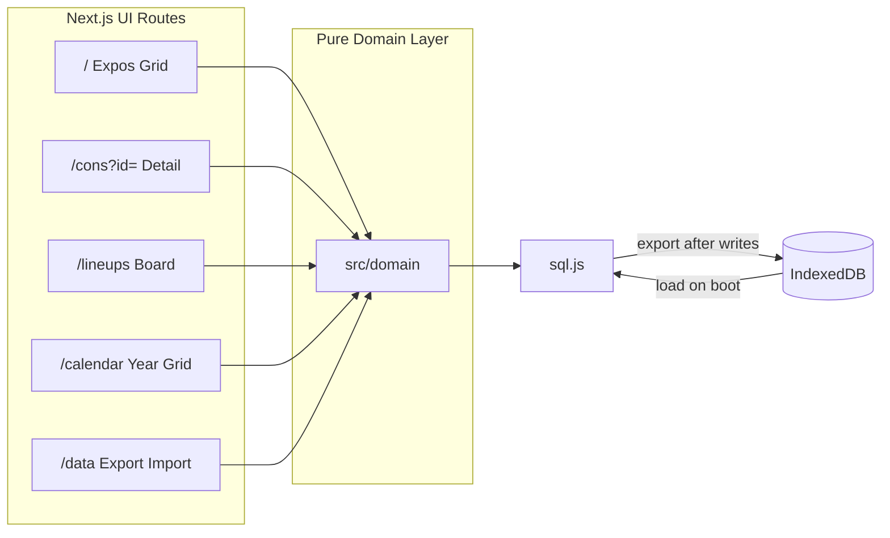
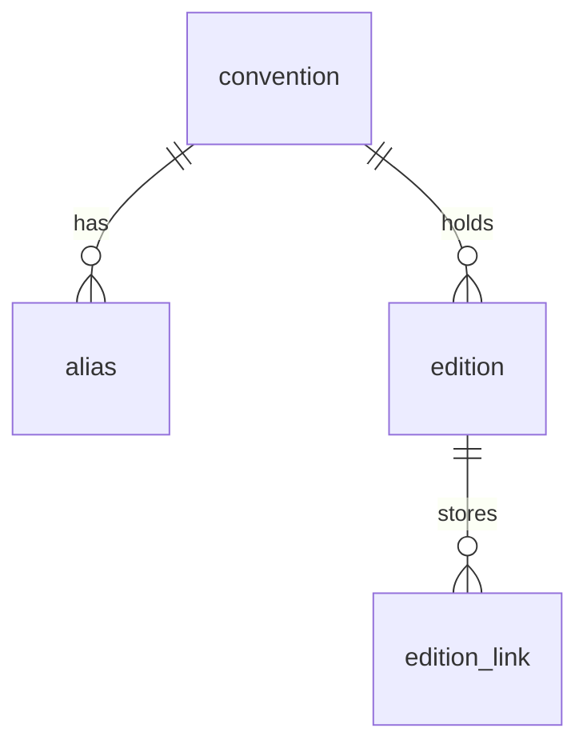
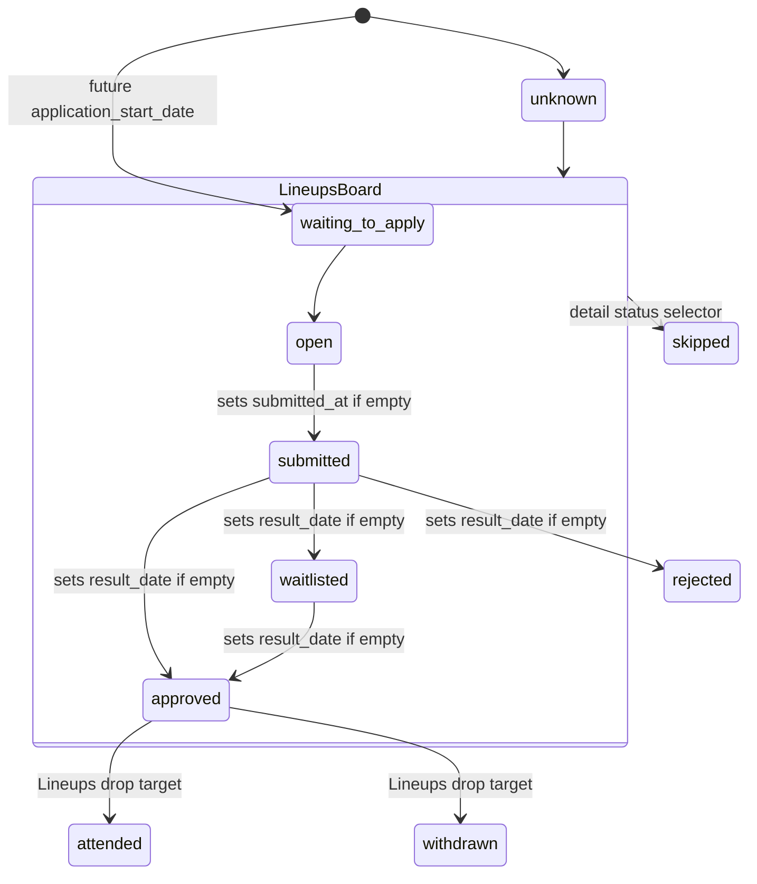

# Expo Tracker Design

Expo Tracker is a local-first, single-user web app for managing artist-alley applications to recurring conventions and expos. It replaced a personal spreadsheet where convention years were embedded in row names, statuses were inconsistent, and links were mixed together.

## Core Principles

- **Single owner, local-first:** Runs entirely in the browser. SQLite lives in memory via sql.js and is persisted to IndexedDB on this device. No accounts, cloud sync, or multi-user auth.
- **Artist alley only:** Each edition tracks the artist's artist-alley application for one occurrence of a convention series.
- **Pure domain layer:** View placement, sorting, interest scoring, date auto-fill, status transitions, and `.ics` generation live in pure functions under `src/domain/` with unit tests. Client pages call those functions against the in-browser database.
- **Explicit calendar export:** Saving a date never triggers network calls or background calendar writes. When an edition has an application start or event start date, the owner can download a snapshot `.ics` file or open a Google Calendar template link.
- **Consistent dates and names:** All dates are `YYYY-MM-DD` in `America/Los_Angeles`. Display names (including Chinese characters) are preserved.

## Runtime & Architecture

| Command | Role |
| --- | --- |
| `pnpm dev` | Starts the Next.js App Router UI on `http://127.0.0.1:4747`. |
| `pnpm test` | Runs unit tests across `src/domain/*.test.ts`, `src/lib/*.test.ts`, and `src/db/*.test.ts` using `tsx --test`. |
| `pnpm build` | Static-exports the app to `out/`. |
| `pnpm start` | Serves `out/` on `http://127.0.0.1:4747`. |

- **Stack:** TypeScript, Next.js App Router (static export), Tailwind CSS, shadcn/ui, `@dnd-kit`, Drizzle ORM, and sql.js.
- **Persistence:** IndexedDB (`expo-tracker` / `sqlite` / `vendor`) holds exported SQLite bytes. `drizzle/` SQL migrations are bundled into the client and applied on open. **Data** (`/data`) exports pretty-printed JSON and imports JSON or a `.sqlite` file (opened in a throwaway sql.js workspace, migrated, then converted to the same JSON document). Import previews added/updated/removed expos, then commits a merge or a replace.

### Module Map

| Module | Responsibility |
| --- | --- |
| `src/db` | sql.js workspace wrapper, IndexedDB helpers, SQLite schema (`src/db/schema.ts`), bundled Drizzle migrations, and in-memory test opener. |
| `src/domain` | Pure domain logic: conventions, editions, aliases, name normalization, status rules, Expos sorting, Lineups board & drag rules, Calendar markers, `.ics` and Google Calendar builders, JSON data files, and mock cleanup. |
| `src/components` | Shared UI components (`convention-title.tsx`, `edition-date-fields.tsx`, `interest-gauge.tsx`, `confirm-form.tsx`, `theme-toggle.tsx`, `theme-script.tsx`). |
| `src/lib` | Theme preference, convention URLs, and `.ics` download helper. |
| `src/app` | Static Next.js App Router pages, `DatabaseProvider`, and client mutations. |

## Data Model

### `convention`

Represents a recurring convention series (e.g., FanimeCon).

| Column | Notes |
| --- | --- |
| `id` | Integer primary key. |
| `display_name`, `normalized` | Preserved name and its unique normalized match key. |
| `website` | Stable convention URL. |
| `default_city`, `default_region` | Convention city and state (labeled **City** and **State** in the UI). Location lives only on the convention. |
| `estimated_attendance` | Expected crowd size at the convention level, or `null` when unknown. |
| `manual_interest` | Signed integer adjustment (default `0`). |
| `notes` | Free text. |

### `alias`

Alternative name for a convention that normalizes to a different key (e.g., `ALA` for Animé Los Angeles, `cpac` for Castlepoint).

| Column | Notes |
| --- | --- |
| `id`, `convention_id` | Cascades on convention delete. |
| `name`, `normalized` | Display alias and unique normalized match key (shared uniqueness namespace with `convention.normalized`). |

### `edition`

One occurrence of a convention series (e.g., cycle `2027`, `2027-winter`, or `109`).

| Column | Notes |
| --- | --- |
| `id`, `convention_id`, `cycle_label` | `(convention_id, cycle_label)` is unique. Cascades on convention delete. |
| `start_date`, `end_date` | Event start and end dates (`YYYY-MM-DD`). |
| `application_start_date`, `application_end_date` | Artist-alley application window dates (`YYYY-MM-DD`). |
| `status` | Single lifecycle status (see [Status Vocabulary](#status-vocabulary)). |
| `submitted_at`, `result_date` | Date applied and expected/actual decision date (`YYYY-MM-DD`). |
| `paid` | Boolean flag toggled manually on `approved` or `attended` editions. |
| `notes` | Free text (e.g., reason for skipping). |
| `sheet_row_key` | Optional unique key (`rawName`) for idempotent sheet re-imports. |

### Supporting Tables

- **`edition_link`:** `(id, edition_id, url, kind)` storing classified URLs (`discord`, `gmail`, `google_form`, `eventeny`, `eventhub`, `other`). Cascades on edition delete.

## Domain Rules

### Naming, Aliases, & Edition Identity (`src/domain/names.ts`)

One normalization pipeline computes `normalized` keys and splits series names from cycle labels:

1. Peel parenthetical text (e.g., `Castle Point Anime Convention (cpac)`) into `aliasCandidates`.
2. Strip trailing 2- or 4-digit years (`26`, `2027`), season words (`Summer`, `Winter`, `Spring`, `Fall`), or cycle numbers (`108`, `109`) to form the edition's `cycle_label` (`2027`, `2026-summer`, `109`).
3. Unicode NFKD casefold, strip Latin diacritics (`Animé` → `anime`), remove punctuation and spaces, and preserve Chinese characters.

Identity rules:

- `normalized` must be non-empty and unique across both `convention` and `alias`.
- Year and season variants collapse into a single convention series without creating aliases (`FanimeCon 26` + `FanimeCon 27` → `FanimeCon`; `SacAnime Summer` + `SacAnime Winter` → `SacAnime`; `Comic Market 108` + `109` → `Comic Market`).
- Distinctly named events by the same organizer remain separate series (`SJ Made Winter Wonder Market` vs. `SJMade Fest`).

### Status Vocabulary (`src/domain/status.ts`)

Each edition has a single lifecycle status:

| Status | UI Label | Lineups Action Date | Interest Score | Gauge |
| --- | --- | --- | --- | --- |
| `unknown` | Unknown | Excluded | `0` | Hollow |
| `waiting_to_apply` | Waiting to apply | `application_start_date` (`Date not set` sorts first) | `+1` | Yellow |
| `open` | Ready to apply | `application_end_date`, or `application_start_date + 7 days` labeled `Estimated close` | `+1` | Yellow |
| `submitted` | Submitted | `result_date` (`Date not set` sorts first) | `+1` | Yellow |
| `waitlisted` | Waitlisted | `start_date` (`Date not set` sorts first) | `+1` | Yellow |
| `approved` | Approved | `start_date` (`Date not set` sorts first) | `+1` | Green |
| `attended` | Attended | Excluded (drop target when dragging `approved` on Lineups) | `+1` | Blue square |
| `rejected` | Rejected | Excluded | `+1` | Scarlet |
| `withdrawn` | Withdrawn | Excluded (drop target when dragging `approved` on Lineups) | `0` | Blue |
| `skipped` | Skipped | Excluded | `-1` | Gray |

When creating a new edition with status `unknown`, if `application_start_date` is in the future relative to today in `America/Los_Angeles`, status initializes to `waiting_to_apply`.

### Interest Calculation (`src/domain/cons.ts`)

- **Total interest (calendar filter):** `conventionInterest = manual_interest + sum(editionInterest(edition.status))`. Calendar includes a convention when this value is greater than `0`.
- **Gauge:** One CSS tick per edition, plus one light-pink tick per positive `manual_interest`. Negative manual interest does not render ticks. Attended ticks are squares; every other status is a rectangle whose height matches the square side and whose width satisfies `side = 2 × width + gap`, so one attended square occupies the same width as two rectangles plus the gap between them. Ticks are grouped left to right: manual (light pink), unknown (hollow), waiting/ready/submitted/waitlisted (yellow), approved (green), attended/withdrawn (blue), rejected (scarlet), skipped (gray). Hover and `aria-label` use a zero-omitting summary such as `3 interest, 1 submitted, 2 attended`. An empty gauge renders nothing.
- **Expos Interest sort:** Gauge `sortCount` descending (editions + positive manual ticks, including hollow unknown; each attended tick counts as 2), then `display_name`. Expos cards use a neutral `--card` background with no interest tint or score number.
- **Display:** The gauge sits under the convention name on Expos, Lineups (convention-level), Calendar chips (compact), and `/cons?id=`. Detail shows the summary in plain text and keeps the **My interest** field.

### Date Auto-fill & Status Transitions (`src/domain/editionDates.ts`, `src/domain/statusDates.ts`)

- **Form date auto-fill (`fillEditionDates`):** In the Add and Edit edition forms, setting `application_start_date` auto-fills an empty `application_end_date` (`+7 days`) and an empty `result_date` (`+1 calendar month`, clamped to month-end). Setting `start_date` auto-fills an empty `end_date` (`+1 day`). Existing dates are never overwritten, and cleared fields stay empty on save.
- **Status transition auto-fill (`fillStatusDates`):** When an edition transitions to a new status (via `/cons?id=` or dragging on `/lineups`), moving into `submitted` fills an empty `submitted_at` with today's Los Angeles date, and moving into `approved`, `waitlisted`, or `rejected` fills an empty `result_date` with today's date. Saving without changing status does not refill cleared dates.

## Views & Routes

Top navigation links **Expos**, **Lineups**, **Calendar**, and **Data**, alongside a **System / Light / Dark** theme toggle persisted in `localStorage` (`expo-tracker-theme`).

| Route | Purpose |
| --- | --- |
| `/` | **Expos grid:** Compact catalog of expos with add-expo form and four sort modes. |
| `/cons?id=` | **Expo detail:** Interest gauge, **My interest**, expo metadata & delete, aliases, and editions ordered by `cycle_label`. (`/series?id=` redirects here.) |
| `/lineups` | **Lineups board:** Five-column drag-and-drop status board ordered by each column's action date. |
| `/calendar` | **Calendar grid:** Read-only 12-month year view of application opens and event starts for interested expos. |
| `/data` | **Data:** JSON export and JSON-or-SQLite import with a preview/commit step. |

### Expos (`/`)

Each tile summarizes one representative edition for its convention:

1. Nearest upcoming edition with `start_date >= today`;
2. Otherwise, most recent past edition with `start_date < today`;
3. Otherwise, the edition with the greatest `cycle_label` (or **No editions** when none exist).

Equal-date ties break by `cycle_label`. Sort buttons are **Name**, **Interest**, **Time of year**, **State** (hover titles: sort by names / interest gauge (attended counts as two) / time of year / state names). Default is **Name** (`/` with no `?sort=`). Sorts (with `display_name` ascending as final tie-breaker):

- **Name (`name`):** `display_name` ascending.
- **Interest (`interest`):** Gauge `sortCount` descending (attended ticks count as 2).
- **Time of year (`time`):** Summarized `start_date` month (`1..12`) ascending, ignoring year, unknown values last.
- **State (`state`):** `default_region` ascending, unknown values last.

When a convention has a valid HTTP(S) or host-like `website` (`hrefForWebsite`), its title on Expos, Lineups, and the detail header renders as an external link opening in a new tab while the rest of the card links to `/cons?id=`.

### Lineups (`/lineups`)

Displays editions in `waiting_to_apply`, `open`, `submitted`, `waitlisted`, and `approved` across five columns:

- Within each column, cards without an action date (**Date not set**) sort first, followed by dated cards ascending, then convention name, then `cycle_label`.
- Each card shows the convention title, cycle label, convention-level interest gauge, action date copy (`Applications open MM/DD`, `Apply by MM/DD`, `Estimated close MM/DD`, `Results expected MM/DD`, or `Event starts MM/DD`), relative day label from today (`today`, `in 3 days`, `2 days ago`), and convention city/state.
- Cards can be dragged (via pointer or keyboard) across any of the five columns. Dragging an `approved` card reveals **Attended** and **Withdrawn** drop targets at the bottom of the board, which transition the edition and remove it from Lineups.

### Calendar (`/calendar`) & Calendar Exports

- **In-app year grid (`/calendar?year=YYYY`):** Plots `application_start_date` (**Application opens**, amber) and `start_date` (**Starts**, emerald) for editions whose convention has `conventionInterest > 0`, including past dates. Excludes `skipped` and `withdrawn` editions. Each chip shows a compact convention-level gauge under the name. Day cells show **⚠️** next to the date when any marker is an `application_start` for a `waiting_to_apply` or `open` edition, and **✈️** when any marker is an `event_start` for an `approved` edition. Both can appear on the same day (**⚠️** then **✈️**); duplicates collapse to one of each. Attention days keep the normal cell background and use a 2px inset ring in a color distinct from the chips: orange for apply, sky for travel (and for mixed days). They do not take the past-day fade. Hovering the day cell (not a chip) shows **Remember to apply for {names}!** and/or **Remember to vend at {names}!**, with convention plus cycle joined by *and* when several editions share a badge. Other statuses still plot chips without badges and still fade when past. **Previous** and **Next** page by year and disable only when no markers exist beyond the viewed year; **Today** jumps to the current Los Angeles year and `#month-YYYY-MM`.
- **Per-date exports:** On `/cons?id=`, saved editions with `application_start_date` or `start_date` render **Download .ics** and **Google Calendar** controls inline beside the field label:
  - `start_date` title: `{Convention} {cycle_label} starts`
  - `application_start_date` title: `{Convention} {cycle_label} artist alley opens`
  - `.ics` files are generated in the browser and contain one all-day `VEVENT` in `America/Los_Angeles` with two `DISPLAY` `VALARM`s: 1 day before (`-P1D`) and 09:00 on the event day (`PT9H`).
  - **Google Calendar** links open `https://calendar.google.com/calendar/render?action=TEMPLATE...` in a new tab.

### Data (`/data`)

Export writes pretty-printed JSON (`expo-tracker-YYYY-MM-DD.json`, date in the browser’s local timezone). The document has `format: "expo-tracker"`, `version: 1`, and a nested `conventions` list keyed by series name (no database ids). Empty fields are omitted. Edition dates inside the file stay `YYYY-MM-DD` in `America/Los_Angeles`.

- **Include application status** (default on): when off, omit `status`, `submittedAt`, `resultDate`, `paid`, `interest`, and notes so a shared file cannot overwrite someone else’s application on merge.
- **Export all N expos** (default on): when off, show every expo sorted by name, all unselected, and the user opts in. Download is disabled until at least one expo is selected.

Import accepts `.json`, `.sqlite`, and `.db`. SQLite files are opened in a throwaway sql.js workspace (migrations apply), converted with application status included, then previewed against the live workspace. Commit does not swap the live database until the owner confirms.

- Match an incoming expo to a local row when its `name` or an alias shares a `normalized` key.
- **Merge** (replace off, default): insert new expos and cycles; overwrite fields that are present in the JSON; leave omitted fields (including status when the file has none) unchanged; add missing aliases and skip collisions with a warning; replace an edition’s links only when `links` is present. Delete nothing. Removed count is 0.
- **Replace** (replace on): same writes, plus delete local expos that have no match in the file. Confirm before commit.
- Preview counts **expos**: added, updated, removed. A new edition on an existing expo counts as that expo updated.

## Testing & Verification

- **Unit tests (`pnpm test`):** Exercise domain logic against in-memory sql.js databases.
- **Browser verification:** Manual and browser checks run against the in-browser IndexedDB workspace. Never create, edit, drag, or delete real (non-mock) expos or editions:
  - Prefix test expos with `[MOCK]` (e.g., `[MOCK] Calendar Con`).
  - Prefix test edition cycles with `mock-` (e.g., `mock-2027`).
  - Delete each `[MOCK]` expo from its expo detail page before and after browser verification so aborted runs do not leave mock rows behind. `cleanMockData` (`src/domain/mock.ts`) remains for unit tests.
