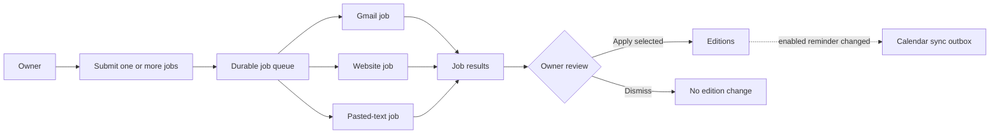
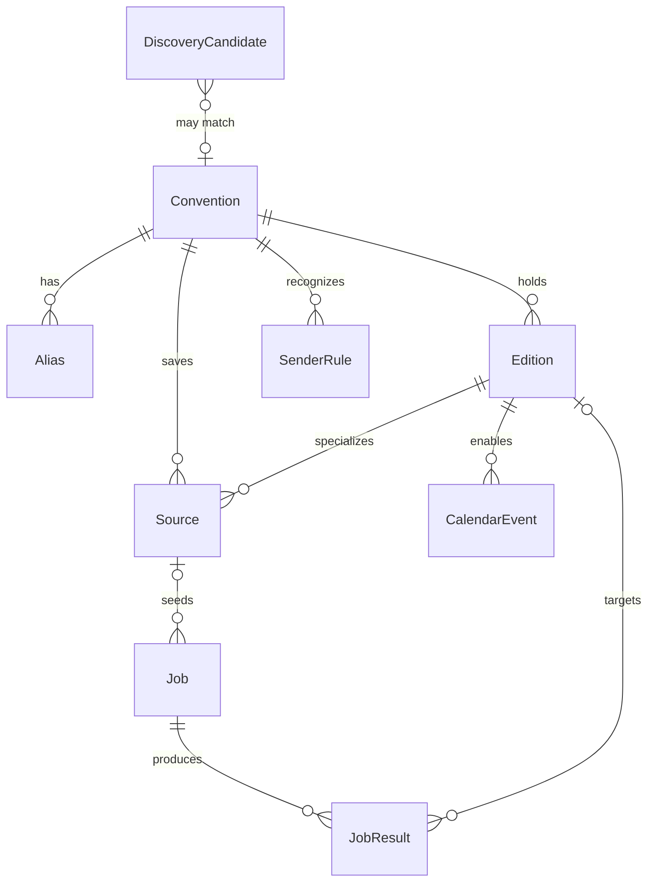
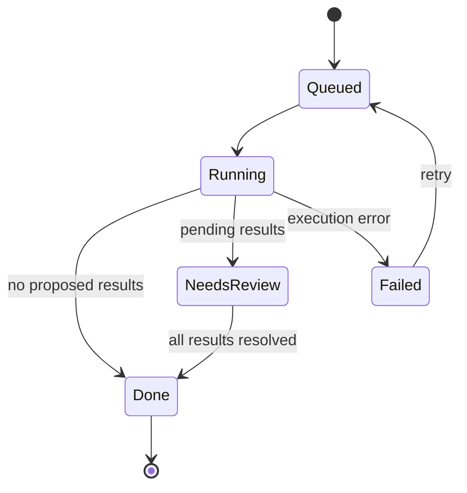

# Expo Tracker design

Expo Tracker is a local, single-user app for managing artist-alley applications.

## How to use this document

1. Find the first milestone marked `not started` in the status table.
2. Read that milestone's section, plus [Locked decisions](#locked-decisions), [Domain model](#domain-model), and [Jobs and review](#jobs-and-review).
3. Implement only that milestone. Do not start later milestones.
4. When finished, mark the milestone `done` and add one dated note describing what landed and what the next agent should know.

Rules for every milestone:

- Put view placement, status transitions, and job-result resolutions in pure functions with unit tests.
- The UI calls those functions.
- Jobs may produce proposed results, but they never change an edition directly.

## Milestone status

| ID | Status | One line |
| --- | --- | --- |
| M0 | done | This design document. |
| M1 | done | Scaffold the local app, SQLite, and an empty shell. |
| M2 | done | Manual series and editions. |
| M3 | done | Import the Google Sheet, with a review queue. |
| M4 | done | Core workspace: Cons, Lineups, shared defaults, and single-status migration. |
| M4.1 | done | Location is city and state only. |
| M4.2 | done | Delete convention and delete edition. |
| M4.3 | done | Skipped status; no dedicated Skip button. |
| M4.4 | done | Status-weighted interest from edition statuses plus manual interest. |
| M4.5 | done | In-app Calendar tab for application and event dates on interested conventions. |
| M4.6 | done | City and state live only on the convention. |
| M4.7 | done | Time-centric Lineups board with drag-and-drop status moves. |
| M4.8 | done | Auto-fill empty edition dates from application or event start. |
| M4.9 | done | Set empty submitted/result dates when status transitions. |
| M5 | not started | Google connection and explicitly enabled Calendar reminders. |
| M6 | not started | Durable Jobs view and per-job result review. |
| M7 | not started | Manually started Gmail scan jobs. |
| M8 | not started | Manually started website fetch jobs. |
| M9 | not started | Extract application updates from websites and pasted text. |
| M10 | not started | Manually started Discord channel jobs. |
| M11 | not started | Manually started AnimeCons discovery and drive-time planning. |

## Reading map

- **Product rules:** [Product](#product), [Locked decisions](#locked-decisions), and [Out of scope](#out-of-scope).
- **Data and behavior:** [Domain model](#domain-model), [Status vocabulary](#status-vocabulary), and [Jobs and review](#jobs-and-review).
- **Automation:** [Job types](#job-types), [Calendar](#calendar), [Discovery and drive time](#discovery-and-drive-time), and [Google OAuth](#google-oauth).
- **Implementation:** [Module map](#module-map), [Environment](#environment), [Milestones](#milestones), and [Testing](#testing).

## Product

### Problem

The owner applies to artist alleys at conventions that repeat every year. The current tool is a [Google Sheet](https://docs.google.com/spreadsheets/d/1DBenfdO_Q0WZC5pKcRbgCyC94CCDoEyNK9uoJgElK_Q/edit?usp=sharing) with:

- one row per convention edition;
- the year embedded in the convention name;
- inconsistent status terms; and
- links mixed across websites, application forms, Discord, and Gmail.

The app replaces that sheet as the place to edit. The sheet is imported once and then left as an archive. There is no sync back to Google Sheets.

### Primary views

- **Cons** is the stable catalog. It uses a compact grid with one tile per convention.
- **Lineups** is a five-column board of active editions, grouped by status and ordered by each column's action date.
- **Calendar** is a year grid of application-start and event-start dates for conventions with interest above zero. Application opens are yellow; con starts are green. It is not an alarm and does not create Google Calendar events.
- **Jobs** is where the owner starts Gmail, website, pasted-text, Discord, or discovery work and later reviews each job's results.
- **Settings** holds the Google connection and app-wide configuration.
- **Import** remains a setup tool and is not permanent primary navigation.

### What jobs detect

Jobs look for only three actionable signals:

1. A con announced an application opening date.
2. Applications are open now.
3. An email says the owner was approved, rejected, or waitlisted.

Everything else on a con or edition is edited manually.

### Review model

External collection runs only when the owner submits one or more jobs. Each job is independent and stores evidence-backed proposed results. A result changes an edition only after the owner opens that job and applies it. Starting several jobs together is a submission convenience, not a persistent batch or review group.



## Locked decisions

These choices are settled and should not be reopened during implementation.

### Scope and ownership

- **Single owner:** No accounts, roles, or sharing. The first connected Google account becomes the owner. If `OWNER_EMAIL` is set, OAuth must match it.
- **Artist alley only:** An edition represents the owner's artist-alley application for one occurrence. If a page lists both dealer and artist-alley dates, use the artist-alley dates. Treat a generic vendor page as low confidence.
- **English UI, preserved names:** Map Chinese sheet statuses during import, but preserve imported display names, including Chinese names.

### Runtime and automation

- **Local app:** Run a Next.js UI and a worker from one repository, with SQLite on the owner's machine. This is not a hosted multi-user service.
- **Manual collection:** Gmail, websites, pasted text, Discord, and discovery run only in jobs the owner submits. There is no polling schedule.
- **Human application:** A job result never writes a status or date directly. The owner applies or dismisses results from that job.
- **Durable jobs:** Queued and running jobs survive navigation and app restarts. They resume when the local worker runs again.
- **No Inbox:** Jobs own result review, Lineups owns upcoming work, and Google Calendar owns alerts.
- **Discord bot only:** Use an invited bot on explicitly configured channel IDs. Never use a self-bot or the owner's user token.

### Reminders and discovery

- **Calendar reminders are opt-in:** Saving a convention start date or application open date does not create an event. The owner explicitly adds a reminder for either date.
- **Enabled reminders stay synchronized:** Once added, a reminder follows later edits to that date until the owner removes it.
- **Drive range:** "Local" means at most 12 hours of driving from San Mateo, CA. Discovery defaults to that range and puts farther conventions in a second list. The owner may still track a fly-to convention.

## Out of scope

- Submitting applications automatically.
- Writing status from a scrape or an email without a button press.
- Scheduled polling of Gmail, websites, Discord, or discovery sources.
- Automatically adding Calendar reminders merely because a date was saved or applied.
- Dealer, exhibitor, or maker-fair workflows.
- Facebook, Instagram, or other social scraping.
- Polling attendance, fees, or table counts.
- Payment detection. Payment sentences can appear in an email quote, but no job proposes `paid`. The owner can mark an approved application paid by hand.
- Two-way sync with the Google Sheet.
- A public API, mobile client, or multi-user auth.

## Where it runs

Two entry points, one database:

| Process | Command | Role |
| --- | --- | --- |
| Web UI | `pnpm dev` | Cons, Lineups, Calendar, Jobs, Import, Discovery, and Settings. Port **4747**, bound to `127.0.0.1`. |
| Worker | started with the server, also `pnpm worker` | Claims queued jobs and retries Calendar synchronization. |


The server starts the worker once from Next.js `instrumentation.ts`. A global guard prevents hot reload from starting a second loop. `pnpm worker` runs the same queue consumer for debugging. A job that lacks required credentials fails with a clear error; unrelated jobs continue.

Laptop sleep is expected. Queued and unfinished jobs remain in SQLite and resume the next time the app is running. Calendar alarms still fire after an event is created. An always-on `launchd` agent is optional and not part of v1.

### Local files

```text
data/vendor.sqlite     gitignored database
.env.local             gitignored secrets
drizzle/               committed migrations
```

### Stack and date rules

- **Stack:** TypeScript, Next.js App Router, Tailwind, shadcn/ui, Drizzle, and better-sqlite3.
- **Package manager:** pnpm.
- **Date-only format:** `YYYY-MM-DD`.
- **Application time zone:** `America/Los_Angeles`.

## Domain model

The core hierarchy is:

- A **convention** is the stable series, such as FanimeCon.
- An **edition** is one occurrence of that series, such as FanimeCon 2027.
- An **alias** is another name for the same series, such as `ALA` for Animé Los Angeles.
- A **source** is an optional saved input for a future job. It belongs to a convention or a specific edition.
- A **job** is one manually requested unit of external collection or analysis.
- A **job result** is an evidence-backed proposed change produced by one job. It may remain unassigned when a Gmail message is ambiguous.



### Convention

The stable series. For example, FanimeCon 2026 and FanimeCon 2027 belong to one convention.

| Field | Notes |
| --- | --- |
| id, display_name, normalized | Display name is preserved. `normalized` is its match key. |
| website | Stable site, not a one-year form URL. |
| default_city, default_region | The convention's city and state. The UI labels them City and State. |
| estimated_attendance | One convention-level expected crowd size. Null when unknown. Import strips commas and a trailing plus: `27,500` is 27500, `1,000+` is 1000, `Unknown` is null. |
| manual_interest | Signed integer, default `0`. |
| drive_minutes | Cached estimated driving time from San Mateo. Null means unknown. |
| drive_source | `seed` or `manual`. A manual value may replace a city seed. |
| notes | Free text. |

A convention has zero or more aliases, shared by every edition. Its `display_name` is always preserved as written.

Changing the default city refreshes a seeded drive time from the new city or clears it when no seed exists. It does not overwrite a manual drive time.

#### Convention summary and sorting

Each Cons tile summarizes one edition:

1. the edition with the nearest `start_date` today or later;
2. otherwise the edition with the most recent past `start_date`; or
3. when every edition is undated, the greatest `cycle_label`.

Break equal-date edition ties by `cycle_label`. A convention with no editions still has a tile and shows **No editions**.

The tile shows convention name, summarized event date, summarized status, and city/region from the convention. A con with no edition still shows its city and state and has no event date or status.

Cons supports four sorts. Convention name ascending is the final tie-breaker for every sort:

- **Interest:** `manual_interest + sum(edition interest)`, descending. Each edition contributes `+1` for waiting to apply, ready to apply, submitted, waitlisted, approved, attended, or rejected; `-1` for skipped; and `0` for unknown, withdrawn, or any other status.
- **Distance:** `drive_minutes`, ascending, with unknown values last.
- **Time:** summarized start month from January through December, ignoring year, with unknown values last.
- **Name:** display name ascending.

The grid tile uses interest as a color cue. Clamp the computed total to `-5…+5` for color only: `-5` is red, `0` is neutral, and `+5` is green. Do not show the number visibly in the grid. Include it in the tile's accessible name. On the con detail page, place the unclamped total under the convention name as an equation with hearts, the editable manual interest input, and grouped edition status counts (for example, `Interest Score ❤️❤️❤️ = [2] + 1 submitted`). Show one ❤️ per positive interest point, one 💔 per negative point, and none at zero.

### Alias

Another name for a convention that remains different after applying the edition identity rules.

| Field | Notes |
| --- | --- |
| id | |
| convention_id | The series this name means. |
| name | As written: `ALA`, `cpac`, `Comic Market`. |
| normalized | Same match key as on a convention. |

#### Normalization

One function computes `normalized` for both convention display names and aliases. Import, Gmail, and discovery all use it:

- Unicode casefold and strip Latin diacritics, so `Animé` matches `Anime`.
- Remove punctuation and interior spaces.
- Remove a trailing year and season word, using the edition identity rules below.
- Preserve Chinese characters.

For example, `ALA`, `ala`, and `A.L.A.` all normalize to `ala`.

#### Constraints and matching

- Reject a key that normalizes to an empty string.
- A `normalized` value must be unique across conventions and aliases.
- Treat a collision as a merge proposal, not a second row. The importer proposes the merge and the owner confirms it in the review queue.
- Confirmation inserts the alias. A name entered on the con detail page also inserts an alias.
- Changing a convention's display name recomputes its `normalized` key.
- Discovery and jobs may read aliases but never create them.

To match an incoming name, normalize it and look for that key on conventions and aliases. One match is high confidence. Multiple matches remain unresolved.

Year and season variants are not aliases:

- `FanimeCon 26` and `FanimeCon 27` are one series under the edition identity rules.
- `cpac` → Castlepoint, `ALA` → Animé Los Angeles, and `Comic Market` → Comiket are aliases. Those aliases are confirmed by the owner; the name function does not hard-code them.
- Trailing cycle numbers such as Comiket `109` remain on the edition.

### Edition

One occurrence of a convention. Example cycle labels are `2027`, `2027-winter`, and `109` for Comiket.

| Field | Notes |
| --- | --- |
| convention_id, cycle_label | Unique together. |
| start_date, end_date | When the event runs. The sheet often has only a start. End may be null. |
| application_start_date | Day artist-alley applications open. Null until known. |
| application_end_date | Day they close. Null until known. |
| start_reminder_enabled | True only after the owner explicitly adds the event-start reminder. |
| application_start_reminder_enabled | True only after the owner explicitly adds the application-start reminder. |
| start_date_calendar_event_id | Google event id for `start_date`. Null until created. |
| application_start_date_calendar_event_id | Google event id for `application_start_date`. Null until created. |
| status | See the status vocabulary. |
| submitted_at, result_date | Dates. `result_date` is expected while Submitted/Waitlisted and actual after a decision. |
| paid | The owner toggles this on an Approved or Attended edition. No job sets it. |
| notes | The sheet's 注释 column. A reason for skipping goes here. |

#### Date behavior

- Saved dates appear in Lineups according to the action-date rules below. There are no clock notices.
- Saving or applying a date never enables a reminder.
- The owner may explicitly add a Google Calendar reminder for `start_date` or `application_start_date`.
- Once enabled, later edits to that date queue a patch to the stored Google event.
- Clearing an enabled date deletes its event and disables that reminder.
- `end_date` and `application_end_date` never create calendar events.
- Import writes dates but leaves both calendar event IDs null.
- A job result that changes a reminder-enabled date applies its database change first and queues retryable Calendar synchronization.

#### Edition identity

- Strip a trailing year (`2027`, `27`, `26`), a season word (`Summer`, `Winter`, `Spring`, `Fall`), or another trailing cycle number (`108`, `109`).
- `Comic Market 108` and `Comic Market 109` are one series, cycles `108` and `109`. `Comiket 109` is a different series until the owner adds `Comic Market` as an alias.
- SacAnime Summer and SacAnime Winter are one convention, cycles `2026-summer` and `2027-winter`.
- SJ Made events at different times of year are separate series. `SJ Made Winter Wonder Market` and `SJMade Fest` do not merge. `Winter Wonder Market 2026` and `Winter Wonder Market 2027` are editions of the same series.

### Source

A source is optional reusable input for a manually started job. Saving one does not schedule work.

| Field | Notes |
| --- | --- |
| convention_id, edition_id | At least one is set. Edition-specific forms should target the edition; stable homepages may target only the convention. |
| kind | `html`, `eventeny`, `eventhub`, `google_form`, `gmail_query`, or `discord_channel`. |
| label | Owner-facing name. |
| target | URL, Gmail query, or Discord channel ID. |
| created_at, updated_at | |

A job may instead use one-off input. Every job copies its effective source kind, target, edition context, and options into `input_json`, so editing a saved source cannot change a past job.

### Job

One unit of work. A single submit action may insert several jobs in one transaction, but there is no batch table and the Jobs UI does not group them by submission.

| Field | Notes |
| --- | --- |
| kind | `gmail`, `website`, `pasted_text`, `discord`, or `discovery`. |
| source_id | Nullable for one-off jobs. |
| input_json | Immutable snapshot of job inputs and edition context. |
| state | `queued`, `running`, `needs_review`, `done`, or `failed`. |
| error | Failure summary. Null unless failed. |
| attempts, lease_expires_at | Support durable claims and recovery after an interrupted worker. |
| created_at, started_at, finished_at | |

The Jobs view groups all jobs by state. The worker claims queued jobs with a lease and requeues an expired claim. A process interruption does not lose completed results.

### Job result

| Field | Notes |
| --- | --- |
| job_id | Originating job. |
| edition_id | Nullable until the owner assigns an ambiguous result. |
| kind | `opening_date`, `applications_open`, or `decision`. |
| dedupe_key | Stable source identity, such as Gmail message id or source plus snapshot hash and proposal kind. |
| proposal_json | Dates, `open`, or `approved` / `rejected` / `waitlisted`. |
| evidence_quote, evidence_url | What the owner reads before applying. |
| confidence | `high` or `low`. |
| state | `pending`, `applied`, or `dismissed`. |
| created_at, resolved_at | |

A completed execution with no proposed changes goes directly to `done`. A job with any pending result moves to `needs_review`; it becomes `done` only when every result is applied or dismissed.

`dedupe_key` is unique across job results. When a later job finds the same Gmail message or the same source snapshot and proposal, it reports **Already seen in job …** and neither moves nor duplicates the original result.

### Other tables

- `sender_rule`: email domain → convention id, created when the owner assigns an ambiguous Gmail result.
- `snapshot`: source or job id, fetched_at, content hash, extracted text. Keep the latest few per source.
- `calendar_sync`: edition id, reminder kind, action (`create`, `patch`, `delete`), state, attempts, last error.
- `discovery_candidate`: external id, name, dates, city, drive minutes, state `new` / `tracked` / `ignored`.
- `drive_time`: city key → minutes, source (`seed` or `manual`).
- `google_credential`: single row, refresh token, scopes, and Gmail history cursor.
- `setting`: owner email, timezone, drive-limit hours (default 12), calendar id.

## Status vocabulary

An edition has one lifecycle status. There is no separate intent field.

| Status       | UI label         | Meaning                                         | Lineups action date                         | Interest |
| ------------ | ---------------- | ----------------------------------------------- | ------------------------------------------- | -------- |
| `unknown`    | Unknown          | No reliable application state yet.              | Excluded.                                   | `0` |
| `waiting_to_apply` | Waiting to apply | Owner is actively waiting for applications to open. | Application start. Missing dates sort first as Date not set. | `+1` |
| `open`       | Ready to apply   | Window is open and the owner has not submitted. | Application end. If missing, application start plus 7 days, labeled estimated. | `+1` |
| `submitted`  | Submitted        | Owner applied and awaits a result.              | Result date. Missing dates sort first as Date not set. | `+1` |
| `waitlisted` | Waitlisted       | Owner is on the waitlist.                       | Event start. Missing dates sort first as Date not set. | `+1` |
| `approved`   | Approved         | Application was approved.                       | Event start. Missing dates sort first as Date not set. | `+1` |
| `attended`   | Attended         | Owner went. Set by hand. No job sets it.        | Excluded. Reachable by dragging Approved onto Attended. | `+1` |
| `rejected`   | Rejected         | Application was rejected.                       | Excluded.                                   | `+1` |
| `withdrawn`  | Withdrawn        | Owner backed out.                               | Excluded. Reachable by dragging Approved onto Withdrawn. | `0` |
| `skipped`    | Skipped          | Owner decided not to apply.                     | Excluded.                                   | `-1` |

Lineups is a five-column board of `waiting_to_apply`, `open`, `submitted`, `waitlisted`, and `approved`. Each column keeps **Date not set** cards first, then sorts by that column's date ascending, then convention name, then cycle label. Cards lead with the named date (`Applications open 11/06`, `Apply by 11/13`, `Estimated close 11/13`, `Results expected 11/20`, or `Event starts 03/15`), a relative cue from today (`today`, `in 3 days`, `2 days ago`), city and state from the convention (`San Jose, CA`), and hearts for unclamped convention interest: one ❤️ per positive point, one 💔 per negative point, and none at zero.

The owner may drag a card onto any of the five columns to change its status. Dragging an Approved card also reveals Attended and Withdrawn drop targets; dropping there removes the edition from Lineups. The convention detail status selector remains the fallback. An overdue Approved card remains until it is marked Attended or Withdrawn.

### Import status mapping

Map sheet statuses as follows:

| Sheet 状态 | status |
| --- | --- |
| 留意中 | `waiting_to_apply` if an open date is in the future, else `unknown` |
| 已申请 | `submitted` |
| Waitlist | `waitlisted` |
| 已通过 | `approved` |
| 已拒绝 | `rejected` |
| Pass | `skipped`. The note is stored in `notes`. |
| 申请已结束 | `unknown`. Do not guess that the owner missed it. The row stays in the review queue. |

The sheet's `预计总人流` value maps to the convention's `estimated_attendance`, never to an edition. When several rows for one convention contain values, prefer the summarized edition's value, then the nearest other edition with a value using the same upcoming/recent/cycle ordering. Re-import fills this field only when it is null, so it does not overwrite an owner edit.

### Import date heuristic

Interpret `申请日期` using the first matching rule below. Keep unresolved dates and ended windows on `/import` until the owner accepts or edits them.

| Situation | Proposal |
| --- | --- |
| Result date present, and status is submitted, waitlisted, approved, attended, or rejected | `申请日期` is `submitted_at`. Result date is `result_date`. |
| 留意中, date present | `申请日期` is `application_start_date`. |
| 申请已结束, date present, note contains a range such as `9/12 - 9/20` | Propose open and close from the note. |
| Anything else with a date | Unresolved date. Do not attach it to submitted_at or the application dates until the owner picks. |

Examples:

- FanimeCon 27, 留意中, 11/08/2026, note 限时申请 → `application_start_date` 2026-11-08, status `waiting_to_apply`.
- SacAnime Summer 26, 已拒绝, 申请日期 6/5/2026, 申请结果 6/17/2026 → submitted 2026-06-05, result 2026-06-17, status rejected.
- Zenkaikon, 申请已结束, date 2026-09-12, note `AA申请 9/12 - 9/20` → propose open 2026-09-12 and close 2026-09-20 in the review queue.
- SJ Made Winter Wonder Market, 已通过 → status approved. SJ Made Fest is a different series. Yearly repeats of the same named market are editions.

### Import merge rules

The importer must propose these series merges instead of applying them silently:

- FanimeCon 26 with FanimeCon 27;
- SacAnime Summer with SacAnime Winter; and
- Comic Market 108 with Comic Market 109.

These names already collapse under the edition identity rules, so confirmation does not insert an alias. If a name remains different after normalization, such as `cpac` for Castlepoint, propose it as an alias and insert it only after owner confirmation.

## Jobs and review

Jobs and their results have separate lifecycles:

- **Execution:** `queued` → `running` → `needs_review` / `done` / `failed`.
- **Result resolution:** `pending` → `applied` / `dismissed`.

There is no read state, snooze state, Inbox, or cross-job review queue.



### Reviewing one job

Clicking a job opens all of its results and evidence. The owner may assign an ambiguous result to an edition, edit an allowed proposed value, select compatible results, apply the selection, or dismiss results.

| Result kind | Apply writes |
| --- | --- |
| `opening_date` | Set `application_start_date` and, when proposed, `application_end_date`. Leave status unchanged. Do not enable a Calendar reminder. |
| `applications_open` | Set status to `open` only when the current status is `unknown`, `waiting_to_apply`, or `open`. |
| `decision` | Set status to proposed `approved`, `rejected`, or `waitlisted`, and set `result_date` from the message date. |

Required behavior:

- Show low-confidence results normally with evidence and an **Unconfirmed** label.
- Applying selected results validates the complete selection before writing anything.
- Two selected results that propose incompatible values for the same edition field are a conflict.
- The apply operation writes all selected compatible results in one SQLite transaction or writes none.
- Dismissing a result changes no edition data.
- Applying a date never creates a new Calendar reminder. If that date already has a reminder enabled, enqueue Calendar synchronization in the same database transaction.
- A job stays `needs_review` until every result is `applied` or `dismissed`.

### Domain API

- Job submission goes through `createJobs(db, inputs)` so one submit action inserts all requested jobs atomically.
- Result application goes through `resolveJobResults(db, job, resolutions)`.
- The Jobs UI and unit tests call those functions.
- Job runners only append or refresh results through `upsertJobResult`; they never update editions.

## Job types

### Gmail (M7)

Gmail access is read-only. A Gmail job starts only when the owner submits it. By default it scans changes since the last successful Gmail job, using the history API and persisted `history_id`; the job input may instead specify a later lower bound.

Consider a message only when both conditions hold:

1. The message is newer than the edition's creation time.
2. The edition status is `submitted` or `waitlisted`.

Classification labels: `approved`, `rejected`, `waitlisted`, `acknowledgement`, `other`.

- The first three create a `decision` result on the Gmail job with a short quote and the Gmail link.
- Acknowledgement ("we received your application") creates no result.
- Match order: a known sender domain for that convention, then the convention name or an alias in the subject or body, using the alias function.
- If several editions could fit, leave `edition_id` unset and require assignment during job review. Do not guess.

Store only the Gmail message ID, thread ID, and a short quote. Do not store the full message or mailbox.

### Website and pasted text (M8, M9)

#### Website fetch

Each website job uses either a saved source or a one-off URL plus edition context:

1. Perform a conditional fetch.
2. Hash the visible text.
3. Stop if the hash is unchanged.
4. Store a snapshot if the content changed.

There is no fetch cadence. An unchanged fetch finishes `done` with a clear "No page change" outcome. M9 extraction runs after a changed snapshot. A pasted-text job skips fetching and passes the submitted text and edition context directly to the same extractor.

#### Rule-based extraction

Rule parsers, no model required:

- **Eventeny / EventHub.** Read the stable apply-versus-closed state. `open_now` true or false.
- **Google Form.** The "not accepting responses" page means closed. A live form means `open_now` true. Forms do not yield a reliable open date.

#### Prose extraction

Prose from an `html` source or pasted-text job uses this interface:

```text
extractApplicationWindow(text, context)
  → { open_date, close_date, open_now, evidence_quote, confidence }
```

The model provider is configuration, not a hardcoded vendor: `LLM_BASE_URL`, `LLM_API_KEY`, and `LLM_MODEL`.

Pass the convention name, edition `cycle_label`, and event start date as context. If `LLM_API_KEY` is empty, skip prose extraction and create no result. Website jobs still store changed snapshots. Rule-based parsers continue to work without a key.

#### Validation and filing

Downgrade confidence to low when:

- `open_date` is after the edition `start_date`.
- `close_date` is before `open_date`.
- The open date year is not the event year and not the previous year.
- The quote has no artist-alley wording and the page looks like a generic vendor application.
- `open_now = true` creates or refreshes an `applications_open` result on that job.
- A new or changed date creates or refreshes an `opening_date` result on that job.
- A changed page or pasted text with no extracted date creates no result, so the job finishes `done`.

### Discord (M10)

Discord uses the same extractor and result kinds as website jobs. The owner starts a Discord job for a saved channel source; the bot fetches messages since the last successful job for that source. It does not stay connected as a continuous listener. Discord's Message Content intent is required.

Servers that refuse bots are covered by a private forward channel in a server the owner controls: forwarded text goes through the same classifier.

The SacAnime sheet cell already contains a guild, channel, and message URL (`discord.com/channels/...`). A source stores the guild ID and channel ID.

### What a quiet job means

Job details distinguish **No source change**, **No actionable result**, and **Failed**. Because collection is manual, silence between jobs means only that no job ran.

Image-only announcements, Facebook, and Instagram are invisible to these job types.

## Calendar

Each edition can have two opt-in all-day events. Both use `America/Los_Angeles` and have reminders:

- the day before; and
- at 09:00 local time on the event date.

| Date | Title | Stored id |
| --- | --- | --- |
| `start_date` | `{Convention} {cycle_label} starts` | `start_date_calendar_event_id` |
| `application_start_date` | `{Convention} {cycle_label} artist alley opens` | `application_start_date_calendar_event_id` |

### Synchronization rules

- Saving or applying a date does not create an event.
- **Add reminder** sets that date's reminder-enabled flag and queues event creation.
- Editing a reminder-enabled date queues a patch to its existing event.
- **Remove reminder** clears the enabled flag and queues event deletion.
- Clearing a reminder-enabled date queues deletion and clears the enabled flag.
- Dismissing a job result leaves events unchanged.
- Calendar sync operations retry independently. The UI shows queued or failed synchronization instead of claiming that SQLite and Google changed atomically.

Scope: `https://www.googleapis.com/auth/calendar.events`. The app only patches event ids it stored.

There are no in-app date notices or alarms. Lineups shows upcoming work; the in-app Calendar tab (M4.5) is a read-only year grid of stored dates; Google Calendar events are the alarms that work when the laptop is shut.

## Discovery and drive time

M11 adds a manually started discovery job that fetches AnimeCons.com's US schedule for the current and next year.

- Cache the raw response body in `snapshot`.
- Use a User-Agent that identifies this as a personal tracker.
- Fetch slowly and infrequently.
- Do not publish the scraped list.

Each row becomes a `discovery_candidate` matched against conventions:

- Normalize the name with the alias function.
- High confidence if that key hits one convention or alias. Attach as a new edition only after the owner presses Track.
- Otherwise leave it unmatched.

Drive time is a cached city-level estimate from San Mateo. v1 ships a seed table and allows a manual value on conventions and candidates. Unknown cities show **drive time unknown** in the Farther list and sort last in Cons. Do not call a paid routing API.

Seed these planning estimates so the default split is sane (nonstop hours from San Mateo):

| City | Hours | Default list |
| --- | --- | --- |
| San Jose, San Francisco, Sacramento | under 2 | Within a day |
| Los Angeles, Pasadena, Long Beach, Anaheim | about 6 | Within a day |
| San Diego | about 8 to 9 | Within a day |
| Las Vegas | about 8.5 | Within a day |
| Portland | about 10 | Within a day |
| Phoenix | about 13 | Farther |
| Salt Lake City | about 13 | Farther |
| Seattle | about 13 to 14 | Farther |

The card shows the estimated hours. The `drive_limit_hours` setting controls the split and defaults to 12. **Track** creates an edition with status `unknown` and, when a website was found, offers to save it as an `html` source.

AnimeCons does not say whether a con has an artist alley. The owner decides by tracking it.

## Google OAuth

Use a personal Google Cloud project with its consent screen in **Testing** and the owner added as a test user. This is sufficient for the restricted `gmail.readonly` scope. Do not publish the app for verification.

- **Client type:** Web.
- **Redirect URI:** `http://127.0.0.1:4747/api/google/callback`.
- **Scopes:** `openid`, `email`, `https://www.googleapis.com/auth/gmail.readonly`, and `https://www.googleapis.com/auth/calendar.events`.
- **First connection:** Set `access_type=offline` and `prompt=consent` so Google returns a refresh token.
- **Secrets:** Store client ID and client secret in `.env.local`.
- **Tokens:** Store tokens in `google_credential`.
- **Disconnected behavior:** Cons, Lineups, Import, website jobs, and pasted-text jobs still work. Settings clearly shows the disconnected state, and Gmail or Calendar actions explain what is unavailable.

## Module map

Keep these boundaries. A milestone may add files only in the modules it names.

| Module | Responsibility |
| --- | --- |
| `src/db` | Drizzle client, migrations, SQLite path `data/vendor.sqlite`. |
| `src/domain` | Types, status transitions, Cons/Lineups sorting, Lineups board grouping and drag targets, Calendar schedule markers, `createJobs`, `resolveJobResults`, `upsertJobResult`, edition naming, alias normalization. No I/O beyond the db passed in. |
| `src/import` | Sheet CSV parse, heuristics, review decisions. |
| `src/google` | OAuth, token refresh, Calendar create/patch/delete, Gmail list/get. |
| `src/jobs` | Durable queue queries, job claim/finish behavior, and saved source queries. |
| `src/jobs/gmail.ts` | Manual Gmail scan, decision classification, and matching. |
| `src/jobs/page.ts` | Manual fetch, hash, snapshots, and rule parsers. |
| `src/jobs/extract.ts` | `extractApplicationWindow` for website and pasted-text jobs. |
| `src/jobs/discord.ts` | Manual channel fetch through an invited bot. |
| `src/discovery` | AnimeCons fetch, name match, drive-time seed. |
| `src/worker` | Claims queued jobs and Calendar sync operations. No extraction or classification logic of its own. |
| `src/app` | Routes and UI. Calls domain functions. |

### UI routes

| Path | Milestone | Purpose |
| --- | --- | --- |
| `/` | M4 | Cons grid and sorting. |
| `/cons/[id]` | M4 | Convention defaults, interest, aliases, saved sources, and editions. |
| `/lineups` | M4.7 | Five-column status board ordered by each column's action date. |
| `/calendar` | M4.5 | Year grid of application-start and event-start dates for interested conventions. |
| `/jobs` | M6 | Submit jobs and browse Queued, Running, Needs review, Done, and Failed groups. |
| `/jobs/[id]` | M6 | Job evidence, result assignment, apply, dismissal, and retry. |
| `/import` | M3 | Review ambiguous rows and proposed merges. |
| `/discover` | M11 | Within a day, and Farther. |
| `/settings` | M5 | Google connection, owner, and drive-limit hours. Sources are edited on the con page. |

The top navigation shows **Cons**, **Lineups**, **Calendar**, **Jobs**, and **Settings** on every primary page. Import is linked as a setup tool rather than a permanent top-level item. Design for desktop first, but keep the Cons grid, Lineups, Calendar, and Jobs usable at narrow widths. Lineups keeps its five columns and scrolls horizontally when the viewport is narrower than the board. There is no separate mobile design.

Empty states use specific, actionable copy:

- no conventions yet: point to import or add;
- no active editions in Lineups;
- no dates for interested conventions on Calendar;
- no jobs yet, and no jobs in a particular state group;
- Google not connected; and
- no saved sources on a con or edition.

## Environment

`.env.example` contains:

```text
OWNER_EMAIL=
SESSION_SECRET=
GOOGLE_CLIENT_ID=
GOOGLE_CLIENT_SECRET=
GOOGLE_REDIRECT_URI=http://127.0.0.1:4747/api/google/callback
LLM_BASE_URL=
LLM_API_KEY=
LLM_MODEL=
DISCORD_BOT_TOKEN=
```

`SESSION_SECRET` signs the local session cookie. The app is still usable before any of the optional keys exist.

## Milestones

Complete exactly one milestone per session. Every milestone ends with the listed tests or manual verification. Update the status table in the same commit.

M1–M3 below are preserved as historical records of what was built, including the former board, Intent, Inbox, and polling terminology. M4 is the explicit migration away from those concepts.

### M1 — Scaffold

**Deliverables**

- Scaffold Next.js in a subdirectory, then move the files to the repository root. Do not scaffold directly into the filesystem root.
- Add Tailwind, shadcn/ui, Drizzle, and better-sqlite3.
- Serve on `127.0.0.1:4747`.
- Create the SQLite database on first launch.
- Add a home page with real copy that identifies the app as an artist-alley tracker, summarizes its purpose, and links to this design document.
- Add `.env.example` and an accurate README run section.

**Acceptance**

- `pnpm dev` serves the home page.
- A second launch reuses the same SQLite file.

**Out of scope:** Board, OAuth, and detectors.

**Completion note — 2026-11-04:** Next.js runs on `127.0.0.1:4747` with Tailwind, shadcn, Drizzle, and better-sqlite3. The home page explains that an opening date, an open window, or a decision waits for approval. First launch created `data/vendor.sqlite`; a second launch reused it. The worker starts from `instrumentation.ts` or `pnpm worker` and has no detectors. Next agent: the database has no domain tables yet.

### M2 — Manual model

**Deliverables**

- Add migrations for convention, alias, and edition.
- Add UI to create and edit them, including application dates, notes, and the paid toggle.
- On the series page, show aliases and editions in `cycle_label` order.
- Group editions into the defined board columns.
- Route domain writes through `src/domain`.
- Cover status and intent changes with unit tests.

**Acceptance**

1. Add FanimeCon.
2. Add its 2027 edition with application start date 2026-11-08.
3. Confirm it appears under Tracking.
4. Mark it skipped and confirm it moves to Pass.

**Out of scope:** Sheet import and inbox items.

**Completion note — 2026-11-04:** Added convention, alias, and edition tables, with writes in `src/domain`. `/` is the board; `/series/[id]` edits series, aliases, and editions. Both routes set `instant = false` so Cache Components does not block them. Browser check: added FanimeCon and cycle 2027 with application start 2026-11-08 (`not_open`, Tracking), then used Skip and saw it move to Pass with intent `skip`. The FanimeCon row remains in the local database. Next agent: there is no import or inbox yet.

### M3 — Sheet import

**Deliverables**

- Read the 摆摊 sheet from either:
  - the public CSV for spreadsheet `1DBenfdO_Q0WZC5pKcRbgCyC94CCDoEyNK9uoJgElK_Q`; or
  - a downloaded file at `data/sheet.csv`.
- Apply the status vocabulary and date heuristic.
- Keep proposed series merges, proposed aliases, and unresolved date or status rows on `/import` until accepted or edited.
- Leave `polling_enabled` off for every imported convention, including maker-fair rows such as San José Made. The owner enables polling manually.
- Make re-import idempotent by matching a stored sheet-row key. Never duplicate conventions.

**Acceptance**

- A fresh database import creates:
  - one Fanime series with two editions;
  - one SacAnime series;
  - one Comiket series; and
  - a Zenkaikon row in the review queue.
- Unit tests cover the heuristic table, including the three date examples in this document.

**Out of scope:** Polling URLs during import.

**Completion note — 2026-11-04:** Sheet parse and review live in `src/import`. `/import` fetches the public 摆摊 CSV (or `data/sheet.csv` if present). Identity merges stay queued until accepted and do not insert aliases. Fresh-db check in the browser: imported the sheet, accepted Fanime / SacAnime / Comiket merges, then confirmed one Fanime series with 2026 and 2027, one SacAnime, one Comiket, and Zenkaikon still in the unresolved queue (`AA申请 9/12 - 9/20`). Re-import did not duplicate those series. `polling_enabled` stayed off. Next agent: no inbox yet; leftover unresolved sheet rows are still on `/import`.

### M4 — Core workspace

**Deliverables**

- Migrate conventions with location defaults, convention-level estimated attendance, signed manual interest, and cached/manual drive minutes.
- Consolidate existing edition attendance into each convention using the import selection rule, then remove attendance from editions.
- Migrate editions with address and postal code snapshots, rename `result_at` to `result_date`, remove `intent` and `application_confirmed`, migrate status `accepted` to `approved`, and migrate status `not_open` to `waiting_to_apply`.
- Remove `polling_enabled`. Preserve every convention, alias, edition, imported row key, date, note, and link; only redundant per-edition attendance values are consolidated.
- Update import mapping and writes for the single-status model and renamed fields so re-import remains idempotent.
- Seed each convention's empty defaults from its summarized edition without changing any existing edition. Use nearest upcoming, then most recent past, then greatest cycle label.
- Add persistent **Cons**, **Lineups**, **Jobs**, and **Settings** navigation. Add clear placeholder/empty pages for Jobs and Settings until M6 and M5 fill them in.
- Replace `/` with the compact Cons grid and the four defined sorts. Show name, event time, status, and city/region; use the clamped interest color without a visible number.
- Move `/series/[id]` to `/cons/[id]`, retaining an old-route redirect. Show the true interest total and convention defaults on the detail page.
- Prefill each new edition's location from convention defaults, then store independently editable location snapshots. Attendance remains only on the convention.
- Add `/lineups` with active editions ordered by the defined action-date rules and a Needs dates tail section.
- Put representative-edition choice, interest calculation/clamping, Cons sorting, Lineups action-date calculation, and status transitions in pure domain functions.

**Acceptance**

- Migrating the existing database preserves row counts and imported data, removes Intent, changes every `accepted` status to `approved`, and changes every `not_open` status to `waiting_to_apply`.
- Creating a convention with location and estimated attendance, then adding an edition, copies only the location. The edition has no attendance field.
- Migration and re-import tests cover convention attendance selection and prove that re-import does not overwrite an owner-edited value.
- A Cons tile shows name, event time, Approved/other status, and city/region. Its accessible name includes the real interest score; the visible tile does not.
- Unit tests cover representative-edition fallback including no-edition cons, all four sorts and name tie-breaks, interest color clamping at both ends, each Lineups action-date rule, terminal exclusion, and Needs dates.
- Re-importing the sheet after migration creates no duplicate convention or edition and uses `approved`.
- Browser verification exercises Cons sorting, opens a con detail, creates an edition from defaults, overrides one snapshot field, and confirms its position in Lineups.

**Out of scope:** Job persistence or execution, Google integration, Calendar API calls, and all network access.

**Completion note — 2026-11-05:** Schema `0002` rebuilds convention/edition: single status (`approved` / `waiting_to_apply`), convention location defaults, estimated attendance, interest, drive minutes; editions keep location snapshots and `result_date`. Cons grid (`?sort=`), `/cons/[id]`, `/lineups`, Jobs/Settings placeholders, `/series/[id]` redirect, quieter Import. Browser: distance/time/name sorts, added M4 Verify Con, edition 2027 copied San Jose then city override Sacramento, Lineups dated at 2027-03-01 waiting to apply. Re-import did not duplicate FanimeCon/SacAnime/Comiket; ILLO MART stayed `approved`. Next agent: M4.1 city and state only. `listCons` seeds drive minutes from city when the cache is empty; leftover import queue may still have Comic Market.

### M4.1 — City and state only

**Deliverables**

- Drop venue, street address, postal code, and country from convention defaults and edition location snapshots.
- Keep `default_city` / `default_region` and edition `city` / `region`. Label region as State in the UI.
- Migrate existing databases with schema `0003` without losing city or region values.
- Prefill new editions from convention city and state only.
- Browser-check the con detail forms and Cons/Lineups location labels.

**Acceptance**

- Convention and edition forms expose only city and state for location.
- Creating an edition copies convention city and state; later convention edits do not change existing edition snapshots.
- Migration removes the dropped columns while preserving city and region.

**Out of scope:** Calendar, Jobs, discovery, and any other location enrichment.

**Completion note — 2026-11-05:** Schema `0003` drops venue/address/postal/country from convention defaults and edition snapshots; keeps `default_city`/`default_region` and edition `city`/`region` (UI: State). Forms on `/` and `/cons/[id]` expose only city and state. Browser: created M41 City State Con (Oakland, CA), edition 2027 copied both, city override to Berkeley showed on Cons (`Berkeley, CA`) and Lineups (`Berkeley`). Next agent: M5 Calendar only.

### M4.2 — Delete convention and edition

**Deliverables**

- Add domain deletes for a convention and for a single edition. Convention delete cascades aliases, editions, and edition links; edition delete cascades its links.
- On `/cons/[id]`, show a red **Delete convention** button below Save convention and a red **Delete edition** button on each edition card. Confirm before submit.
- Skip remains a status change to `passed` and does not remove the row.
- Do not add delete controls on Cons tiles or Lineups.

**Acceptance**

- Deleting one edition leaves sibling editions and the convention.
- Deleting a convention removes it from Cons and removes its editions from Lineups.
- Skip still marks passed without deleting.

**Out of scope:** Calendar event cleanup on delete (M5 owns reminders and `calendar_sync`).

**Completion note — 2026-11-05:** `deleteConvention` / `deleteEdition` in domain with cascade via existing FKs; red confirm buttons on `/cons/[id]`. Browser: created M42 Delete Con with 2026+2027, deleted 2026 (2027 remained and showed in Lineups), Skip set 2027 to passed without removing it, then Delete convention redirected to Cons with no M42 tile and no Lineups row. Next agent: M5 Calendar; deleting an edition or convention does not queue Calendar event deletion yet.

### M4.3 — Skipped status, no Skip button

**Deliverables**

- Rename edition status `passed` to `skipped` (UI label Skipped). Migrate existing rows with schema `0004`.
- Map sheet status `Pass` to `skipped`. Treat legacy stored `passed` as `skipped` in `normalizeLegacyStatus`.
- Remove the dedicated Skip button and `markEditionPassed` path. Set Skipped from the edition status dropdown.

**Acceptance**

- Existing `passed` rows become `skipped` after migration.
- The con detail page has no Skip button; saving status Skipped excludes the edition from Lineups.
- Re-import still maps sheet `Pass` to `skipped`.

**Out of scope:** Calendar, Jobs, and other status vocabulary changes.

**Completion note — 2026-11-05:** Status `skipped` replaces `passed`; migration `0004` rewrites existing rows; Skip button removed. Browser: set an edition to Skipped via the dropdown, confirmed Cons label and Lineups exclusion; Delete still present. Next agent: M4.4 interest weights.

### M4.4 — Status-weighted interest

**Deliverables**

- Replace attended-only interest with per-edition scores: `+1` for waiting to apply, ready to apply, submitted, waitlisted, approved, attended, and rejected; `-1` for skipped; `0` for unknown, withdrawn, and any other status.
- Total interest is the sum of edition scores plus `manual_interest`. Keep color clamping at `-5…+5` for Cons tiles only.
- Put the score rules in pure domain functions with unit tests. Update the con detail interest copy.

**Acceptance**

- Cons interest sort and tile color use the new total.
- The con detail page shows the unclamped total from manual interest plus edition statuses.
- Unit tests cover +1 statuses (including attended and open), skipped as −1, unknown/withdrawn as 0, mixed editions with signed manual interest, and color clamping.

**Out of scope:** Calendar, Jobs, schema changes, and storing interest on the convention row.

**Completion note — 2026-11-05:** `editionInterest` scores statuses (+1 applying/applied including attended, −1 skipped, 0 unknown/withdrawn); `conventionInterest` sums those with manual interest. Cons sort/color and con detail copy updated. Browser: created M44 Interest Con with manual 2, Attended 2025, Skipped 2026 → detail showed Interest 2; Cons interest sort listed it with accessible name interest 2 among other +1/−1/0 tiles. Next agent: M4.5 in-app Calendar.

### M4.5 — In-app Calendar tab

**Deliverables**

- Add a primary **Calendar** nav item and `/calendar` year grid (`?year=YYYY`, default current Los Angeles year). Previous/Next move by one year.
- Plot `application_start_date` (**Application opens**, yellow) and `start_date` (**Starts**, green) for editions whose convention has `conventionInterest` greater than 0, including past dates.
- Omit skipped and withdrawn editions even when the series interest is positive.
- Do not plot end dates, application end dates, or result dates.
- Emphasize the current Los Angeles year, month, and day. Provide a **Today** control that jumps to the current year and scrolls to the current month.
- Previous/Next are disabled only when no markers exist before or after the viewed year (empty intermediate years stay reachable).
- Put marker selection and year/month-grid helpers in pure domain functions with unit tests. Keep Lineups unchanged.
- Do not create Google Calendar events or in-app alarms.

**Acceptance**

- An interested convention with an application start and an event start shows two markers; clicking a marker opens the con page.
- Zero-interest conventions and skipped/withdrawn editions do not appear; past dates do appear.
- Previous is disabled when no earlier marker year exists; Next is disabled when no later marker year exists.
- Current year, month, and day are visually distinct; **Today** returns to the current Los Angeles year and month.
- Unit tests cover interest cutoff, skipped/withdrawn exclusion, both date kinds, past and future dates, and year-range paging at marker extrema.

**Out of scope:** Google OAuth, reminder sync, and Jobs.

**Completion note — 2026-11-05:** `/calendar` year grid with `?year=` paging; `scheduleMarkersFromRows` / `listScheduleMarkers` plot future `application_start_date` (Application opens, yellow) and `start_date` (Starts, green) when `conventionInterest > 0`, omitting skipped/withdrawn editions and past dates. Nav order Cons → Lineups → Calendar → Jobs → Settings. Browser: created M45 Calendar Con (manual interest 2, skipped 2026 with Nov/Dec dates, waiting 2027 opens 2026-11-20 starts 2027-03-15); year view showed Application opens and Starts across months; Previous disabled for prior years; marker opens `/cons/51`. Next agent: M5 Google Calendar reminders.

**Follow-up note — 2026-11-05:** Calendar now plots past dates too. Previous/Next disable only at the ends of the marker year range (`canShiftYear`). Current year/month/day are emphasized; **Today** links to `?year={current}#month-{YYYY-MM}`. Empty-state copy no longer says “future only.” Browser: 2026 showed past May/Aug/Sep markers and filled year chip; Previous disabled on earliest marker year, Next disabled on 2027; November headed “Today” with ringed day 5; Today URL scrolled to `#month-2026-11`. Next agent: M5 Google Calendar reminders.

### M4.6 — City and state on the convention only

**Deliverables**

- Drop `city` and `region` from editions. Location lives only on `default_city` / `default_region` on the convention.
- Migrate existing databases with schema `0005`: backfill empty convention city/state from any edition that still has a value, then drop the edition columns. Do not overwrite a convention that already has location.
- Cons tiles and Lineups read city/state from the convention. Edition forms no longer expose location fields.
- Import still fills empty convention city from the sheet's 地点 column; it does not write location onto editions.
- Label convention fields City and State (not Default city / Default state).

**Acceptance**

- Convention forms expose city and state; edition forms do not.
- Creating or editing an edition never stores or changes location.
- Changing the convention city updates Cons tiles and Lineups for every edition of that series.
- Migration preserves convention location, fills empty conventions from edition snapshots when needed, and removes edition `city` / `region`.

**Out of scope:** Calendar, Jobs, discovery, and renaming the `default_*` columns.

**Completion note — 2026-11-05:** Schema `0005` backfills empty convention city/state from edition snapshots, then drops edition `city`/`region`. Cons and Lineups read location from the convention only. Edition create/update/import no longer touch location; con detail labels City/State. Browser: added M46 Location Con (Oakland, CA), edition 2027 with application start 2026-12-01 (no edition location fields), changed city to Berkeley → Cons tile `Berkeley, CA` and Lineups `Berkeley`. Live DB had never applied `0003`, so orphan `venue`/`address`/`postal_code`/`country` columns may remain on `edition` (ignored by the schema). Next agent: M4.7 Lineups board.

### M4.7 — Time-centric Lineups board

**Deliverables**

- Replace the single dated list and Needs dates tail with five fixed columns: Waiting to apply, Ready to apply, Submitted, Waitlisted, and Approved.
- Use the status-specific action dates above. Ready to apply without an end date uses application start plus 7 calendar days and labels that date estimated. Missing dates show **Date not set** and sort first in the column.
- Show a named date line, a relative cue from the current Los Angeles day, city and state, and hearts for unclamped convention interest (❤️ positive, 💔 negative).
- Allow dragging a card onto any of the five columns to change its status. Dragging an Approved card reveals Attended and Withdrawn drop targets. Those moves leave Lineups.
- Put date descriptors, column grouping, sorting, relative cues, and allowed drag targets in pure domain functions with unit tests. Keep a focused status write behind a non-redirecting server action.
- Cards open the exact edition on the convention page. The convention header shows `Interest Score` hearts and the existing equation. Ready to apply is visually stronger. Narrow widths keep five columns and scroll horizontally.

**Acceptance**

- Each column uses its own date rule, including the seven-day Ready estimate and month/year boundaries.
- Undated cards sit above dated cards; dated cards sort by date, then name, then cycle.
- Dragging between visible columns persists after refresh. Approved can move to Attended or Withdrawn; other Lineups statuses cannot.
- Hearts appear as ❤️ for positive convention interest, 💔 for negative, and not at zero.
- Browser verification covers desktop and narrow boards, date copy, estimated styling, click-through, pointer and keyboard moves, and both terminal targets.

**Out of scope:** Calendar reminders, Jobs, and any other status vocabulary changes.

**Completion note — 2026-11-06:** Lineups is a five-column board (Waiting, Ready, Submitted, Waitlisted, Approved) with status-specific dates, LA relative cues, and a 7-day estimated Ready close. Domain lives in `src/domain/lineupBoard.ts`; `moveLineupEdition` plus a non-redirecting action persist drag targets. Hearts use unclamped convention interest as ❤️ (positive) or 💔 (negative); the con header is `Interest Score ❤️ = [manual] + status counts`. Browser: desktop five-column grid, Ready emphasized, estimated italics, Date not set first; keyboard moved M47 2027 waiting→submitted; Approved tray Attended (2028) and Withdrawn (2029) persisted and left the board; after those drops `/cons/54` showed `Interest Score ❤️❤️❤️❤️ = [2] + 1 submitted + 1 attended`; FanimeCon card opens `/cons/24#edition-26`; 390px keeps five columns (`overflow-x`, client 390 / scroll 1344). Next agent: M4.8 edition date auto-fill.

### M4.8 — Edition date auto-fill

**Deliverables**

- When the owner sets an edition application start in the Add or Edit form, fill empty application end with start plus 7 calendar days and empty result with start plus 1 calendar month (same day next month, clamped to the last day).
- When the owner sets an event start, fill empty event end with the next calendar day.
- Never overwrite a date that already has a value. Changing start later does not rewrite filled fields. The owner may edit or clear after fill; values persist only on save.
- Put the calendar arithmetic and fill rules in pure domain functions with unit tests. Import and jobs stay unchanged.
- Show a Result date field on Add edition so the one-month fill is visible before save.

**Acceptance**

- Filling application start alone populates application end and result when those fields were empty.
- Filling event start alone populates event end when it was empty.
- Existing end or result values are left alone. Cleared auto-filled values stay empty after save.
- Unit tests cover week, month, day fills, month/year/leap-year clamps, and no-overwrite.
- Browser verification covers Add and Edit on `/cons/[id]`.

**Out of scope:** Calendar reminders, Jobs, and import date heuristics.

**Completion note — 2026-11-06:** `addCalendarMonths` and `fillEditionDates` fill empty application end (+7 days), result (+1 month, clamped), and event end (+1 day) from start dates. Client `EditionDateFields` on Add/Edit; Add edition now includes Result. Browser on FanimeCon: Add 2028 with app start 2026-11-06 filled end 11/13 and result 12/06; event start 2027-05-22 filled end 05/23; save persisted. Changing start left existing end/result alone; clearing Result and saving kept it empty after reload. Edit 2027 with empty end/result filled on application-start change. Next agent: M4.9 status date automation.

### M4.9 — Status date automation

**Deliverables**

- When an edition actually transitions into `submitted`, set empty `submittedAt` to the current Los Angeles day.
- When an edition actually transitions into `approved`, `waitlisted`, or `rejected`, set empty `resultDate` to the current Los Angeles day.
- Never overwrite an existing date. Saving the same status again must not recreate a date the owner cleared.
- Apply the same rules through the convention status selector and Lineups drag-and-drop. Put the rules in a pure domain helper with unit tests. No schema change.

**Acceptance**

- Moving or saving into Submitted fills Submitted when empty and leaves a filled Submitted alone.
- Moving or saving into Approved, Waitlisted, or Rejected fills Result when empty and leaves a filled Result alone.
- Same-status saves do not refill cleared dates.
- Unit tests cover transitions, no-overwrite, same-status, and unrelated statuses.
- Browser verification covers the convention form and Lineups board.

**Out of scope:** Calendar reminders, Jobs, and import status heuristics.

**Completion note — 2026-11-06:** `fillStatusDates` fills empty `submittedAt` on transition into submitted and empty `resultDate` on transition into approved/waitlisted/rejected; same-status and existing dates are left alone. Wired through `updateEdition` and `moveLineupEdition` with injectable LA `today`. Browser: FanimeCon 2028 form → Submitted then Rejected set both dates to 2026-11-06; Lineups keyboard-drag FanX Waiting→Submitted filled submitted, Momocon Submitted→Waitlisted filled result; both persisted after reload. Next agent: M5 Calendar reminders only.

### M5 — Manual Calendar reminders

**Deliverables**

- Implement OAuth as specified and show either the connected email or a clear disconnected state on Settings.
- Add reminder-enabled flags and the retryable `calendar_sync` outbox.
- Show explicit **Add reminder** and **Remove reminder** actions for edition start and application start dates.
- Never create an event from an ordinary edition save.
- Once enabled, create the all-day event, patch it after date edits, and delete it after removal or date clearing.
- Store each Google event ID on the edition and expose queued or failed synchronization.
- On disconnect, retain local data and stop Calendar calls.
- Keep Calendar calls behind `src/google` so tests can use a fake.

**Acceptance**

- Saving either date without pressing **Add reminder** makes no Calendar call.
- Adding a reminder creates one event; correcting its date patches that event rather than creating another.
- Removing the reminder deletes the event, and clearing an enabled date also disables it.
- A failed fake Calendar call remains queued with a visible error and succeeds on retry.
- Without credentials, the rest of the app runs and Settings explains how to connect. A live test user check is optional when credentials are present.

**Out of scope:** Reading Gmail and in-app date notices.

### M6 — Jobs and review

**Deliverables**

- Add saved source, job, and job-result tables plus `createJobs`, `upsertJobResult`, and `resolveJobResults`.
- Make the worker durably claim queued jobs and recover an interrupted claim.
- Add `/jobs` with a multi-job submission form and groups for Queued, Running, Needs review, Done, and Failed. Do not add batch grouping.
- Add `/jobs/[id]` for evidence, edition assignment, allowed edits, selection, conflict errors, apply, dismissal, and retry.
- Add developer-only sample runners for opening date, applications open, decision, no-result, and failed jobs. They perform no network access.
- Apply selected compatible results from one job in one SQLite transaction. Enqueue Calendar synchronization only when an already-enabled reminder date changes.
- Keep a job in Needs review until every result is applied or dismissed.

**Acceptance**

- One submission creates several independent jobs that appear under their current status rather than a batch.
- Restarting the worker does not lose queued jobs or duplicate completed sample results.
- Applying a sample opening date changes the date without enabling a reminder.
- Applying open, approved, rejected, and waitlisted samples makes the defined status/date changes.
- An ambiguous result can be assigned to an edition; dismissal changes no edition data.
- Conflicting selected results write nothing. Compatible selected results apply together.
- Unit tests cover every result resolution and job-state transition; browser verification covers submission, status groups, review, apply, dismissal, and retry.

**Out of scope:** Gmail, website, Discord, discovery, or other live network calls.

### M7 — Gmail job

**Deliverables**

- Add manually initiated Gmail history scans, classification, sender rules, and `decision` job results.
- Default to changes since the last successful Gmail job and persist the history cursor only after success.
- Use a small set of bilingual patterns, optionally supplemented by the configured model.
- Classify "application received" as an acknowledgement, not a decision.
- Store only message/thread ids, Gmail links, and short evidence quotes.

**Acceptance**

- Fixture messages for approved, rejected, waitlisted, acknowledgement, and other produce the expected job result or silence.
- An ambiguous sender creates a pending result with no edition.
- Assigning an edition stores a sender rule; applying remains a separate owner action.
- Re-running the same fixture history does not duplicate a result.
- No test calls the live Gmail API.

**Out of scope:** Automatically applying a decision or scheduled Gmail polling.

### M8 — Website fetch job

**Deliverables**

- Add website source CRUD to the con detail page, scoped to a convention or edition.
- Let one Jobs submission contain saved-source and one-off URL jobs.
- Fetch queued website jobs in the worker, hash visible text, store changed snapshots, and preserve fetch errors on the job.
- Do not insert another snapshot body when the hash matches; finish with **No page change**.

**Acceptance**

- A local fixture HTTP server, or recorded HTML passed through the same fetch/hash path, proves that:
  - a second identical job stores no duplicate body; and
  - a changed body stores a new snapshot.
- A failed fetch affects only its job and appears under Failed with a retry action.
- The job detail shows source, target edition context, fetch time, hash outcome, and error when present.

**Out of scope:** Extracting dates or creating job results from page text.

### M9 — Extraction and pasted text

**Deliverables**

- Add Eventeny, EventHub, and Google Form parsers.
- Add `extractApplicationWindow` behind the model configuration and apply the date checker.
- Run extraction after a changed website snapshot.
- Add pasted-text jobs that pass submitted text and edition context through the same extractor.
- Create `opening_date` and `applications_open` results through `upsertJobResult`.

**Acceptance**

- Fixture HTML for an Eventeny-style open page, a closed Google Form, and a prose page with an artist-alley date produces the expected job result or expected silence.
- A pasted announcement produces the same result shape as equivalent page text.
- A prose page containing only an event start date creates no opening-date result.
- Low-confidence results are labeled Unconfirmed and still require Apply.

### M10 — Discord job

**Deliverables**

- Let a con or edition save a Discord channel source.
- Add a manually submitted Discord job that fetches messages since the last successful job for that source.
- Pass fetched messages through `extractApplicationWindow` and attach results to the Discord job.
- Support the owner's private forward channel as another saved source.
- Document bot creation, Message Content intent, and invite URL in the README.

**Acceptance**

- A fixture message object containing "Artist alley opens November 8" creates the same result shape as website extraction.
- A second job with no new messages finishes Done with no result.
- With no token, only that job fails clearly; the worker continues processing other jobs.

**Out of scope:** Self-bots, continuous listeners, scheduled polling, and listening to every channel in a guild.

### M11 — Discovery

**Deliverables**

- Add a manually submitted discovery job for AnimeCons's US schedule for this year and next year.
- Add name matching, the city drive-time seed, convention drive-time cache, and manual correction.
- Add `/discover` with **Within a day** and **Farther** lists.
- Add **Track** and **Ignore**.
- **Track** creates an edition with status `unknown` and offers to save an `html` source when a site URL exists.

**Acceptance**

Given a fixture schedule with Fanime already in the database, a new Bay Area convention, and a New York convention:

- Fanime produces one **new edition** suggestion;
- the Bay Area convention appears as a new candidate under **Within a day**;
- the New York convention appears under **Farther**;
- tracking the Bay Area convention makes its cached drive time available to the Cons distance sort; and
- an ignored candidate remains ignored on the next manually started discovery job.

## Testing

- Domain and job milestones: unit tests for the cases named in the milestone. Run them with `pnpm test`.
- UI milestones (M2 onward): exercise the named path in a browser on port 4747. Click through Cons/Lineups, import review, Calendar reminder controls, Jobs review, or settings as applicable. Say what you clicked and what you saw in the milestone note.
- External services stay behind fixtures. Live Google is optional and only when `.env.local` is present.

## Sheet reference

### Source

`https://docs.google.com/spreadsheets/d/1DBenfdO_Q0WZC5pKcRbgCyC94CCDoEyNK9uoJgElK_Q`

Sheet title: 摆摊.

Columns: 名称, 地点, 开展日期, 申请日期, 申请结果, 状态, 预计总人流, 官方网页, 其他连接, 注释.

### Link handling

- During the first import pass, do not automatically turn links in 其他连接 into saved sources.
- The importer may store them as untyped edition links for later promotion.
- Recognize Discord, Gmail, Google Forms, Eventeny, and EventHub URLs so a later UI can offer **Save as source**.
- Promoting a link to a source belongs to M8 or M10, not M3.
